# Lab 1: Building and Evaluating Convolutional Neural Networks

Scalable Machine Learning - Tasks 1-6 and Challenge 2

## Experimental overview

We trained CIFAR-10 adaptations of AlexNet and ResNet-18, investigated capacity,
Dropout and L2 regularization, and evaluated clean, corrupted and adversarial
inputs. The evidence comprises two original baseline runs, six controlled AlexNet
runs and five augmentation/cost runs. Each run used 30 epochs and 1,350,000 training
examples. Challenge 2 evaluates frozen models on STL-10; Challenge 1 was not attempted.

The primary deliverable is `lab1/notebooks/lab1_submission.ipynb`. It executes the
artifact audit, checks the architecture implementation on CPU, and displays the
final measured tables and figures. Training was completed in earlier sessions;
executing this notebook re-displays and checks those results without retraining.
The original executed role notebooks, complete Python implementation, frozen
configurations and histories accompany it. These distinctions also apply to the
notebook's source-code appendix and reproduction instructions.

| Evidence group | Training hardware | Evaluation / inference hardware | Purpose |
|---|---|---|---|
| Original baselines (A), 2 runs | RTX 5070 Ti Laptop | RTX 5070 Ti Laptop | Tasks 1-2; checkpoints reused for Task 5 |
| Capacity / regularization (B), 6 runs | Tesla T4 | Tesla T4 | Task 3 controlled comparisons |
| Frozen A checkpoints, evaluated by B | Original A training | Tesla T4 | Task 5 prediction and attack analysis |
| Augmentation / cost (C), 5 runs | Tesla T4 | Jade RTX 2000 Ada Generation | Tasks 4, 6 and Challenge 2 |

All numerical cost rankings below stay within a hardware group and measurement
procedure. A's original timings remain provenance records; the shared same-device runs
provide the final architecture cost comparison. Moving outputs into Colab does
not change where a model was trained or benchmarked. A's original software was
PyTorch 2.11.0+cu128; B's T4 session used 2.14.1+cu130. The JSON records retain the
environment for each run. Differences between independent runs are not attributed
to hardware alone.

## Task 1: data preparation and reproducibility

Each CIFAR-10 example is a labelled 32 x 32 RGB image. The official 50,000 training
images and 10,000 test images are balanced across airplane, automobile, bird, cat,
deer, dog, frog, horse, ship and truck. Raw arrays are uint8 in [0,255]. We used a
stratified split with seed 2223, preserving 4,500 training and 500 validation images
per class. The official test set has 1,000 examples per class and was reserved for
evaluation after the experiment settings had been fixed.

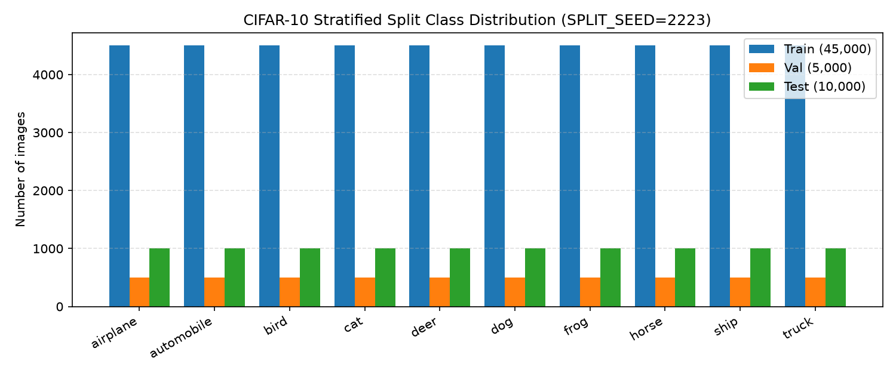

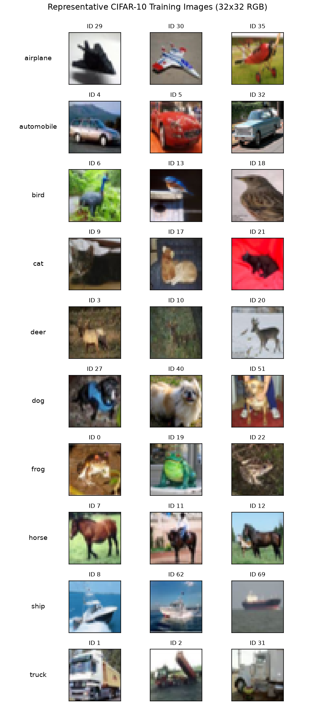

Only the 45,000 training images contributed to channel statistics: mean
[0.4913, 0.4822, 0.4464] and standard deviation [0.2470, 0.2434, 0.2615]. Both
architectures receive the same normalized 32 x 32 inputs. The loaders preserve
raw [0,1] pixels and original image IDs; differentiable normalization is applied
before the model. This keeps Task 5's perturbation constraint in raw pixel units
and allows STL-10 images to use the same preprocessing after resizing.

`split_indices.json` stores the exact disjoint partitions. The shared seed module
sets Python, NumPy, PyTorch and CUDA randomness, and seeded generators fix batch
order. Training seed is 42 except for the shared additional seeds 0 and 123. Fixed seeds
make the procedure repeatable within an environment; floating-point kernels and
software versions can still affect predictions across devices. No test image is
used to compute normalization or select a checkpoint.

## Task 2: implementation and baseline comparison

Both networks are implemented from PyTorch layers without pretrained weights or
`torchvision.models` constructors, following the course Part A9 adaptations.
AlexNet keeps five convolutions and three fully connected layers. Its ImageNet
11 x 11 stride-4 stem is replaced with 3 x 3 stride-1 padding-1 convolutions and
three 2 x 2 stride-2 max pools, preserving useful resolution on 32 x 32 images.
Its two hidden FC layers use ReLU and Dropout 0.5.

ResNet-18 uses a 3 x 3 stride-1 stem and omits ImageNet's initial max pool. Four
stages contain two residual blocks each, followed by global average pooling and
a ten-logit linear head. Each block uses two 3 x 3 convolutions with batch
normalization. The shortcut adds the input to the learned residual; a 1 x 1
projection aligns channels and resolution when they change. This path assists
gradient propagation through the deeper network. No softmax is applied before
cross-entropy, which consumes the raw logits.

| Architecture | Stage outputs (channels x height x width) | Head | Parameters |
|---|---|---|---:|
| AlexNetCIFAR | 64 x 16 x 16; 192 x 8 x 8; 256 x 4 x 4 | 4096 -> 1024 -> 512 -> 10 | 6,976,842 |
| ResNet18CIFAR | stem/stage1 64 x 32 x 32; stage2 128 x 16 x 16; stage3 256 x 8 x 8; stage4 512 x 4 x 4 | GAP -> 512 -> 10 | 11,173,962 |

AlexNet's last convolution group uses 384, 256 and 256 channels before pooling.
Convolution applies shared local filters across the image. For kernel size K,
padding P and stride S, output size is floor((H + 2P - K)/S) + 1. The 3 x 3,
stride-1, padding-1 layers retain spatial size; pooling or stride-2 stage entries
reduce it. Repeated local operations expand the receptive field, allowing later
features to combine edges, textures and object parts. AlexNet allocates roughly
67.7% of its parameters to its FC head, while ResNet's ten-class head contains
only 5,130 parameters.

Both baselines used FP32, batch size 128, SGD with momentum 0.9 and weight decay
5e-4, cosine annealing, no training augmentation and 30 epochs. Learning rates
were 0.01 for AlexNet and 0.1 for ResNet. These architecture-specific rates were
fixed before testing. Checkpoints maximize validation accuracy; lower validation
cross-entropy breaks ties. The budget is equal in examples and epochs, with
different measured compute costs. Train-evaluation passes disable Dropout and
use deterministic preprocessing, making their metrics comparable to validation.

| Metric | AlexNet | ResNet-18 |
|---|---:|---:|
| Selected epoch | 24 | 28 |
| Best validation accuracy | 0.8300 | 0.8730 |
| Selected validation CE | 0.9030 | 0.4223 |
| Original clean test accuracy | 0.8214 | 0.8701 |
| Original test CE | 0.9310 | 0.4357 |
| Original test macro F1 | 0.8205 | 0.8698 |
| Final deterministic training accuracy | 1.0000 | 1.0000 |

ResNet improved clean accuracy by 4.87 percentage points under the equal-epoch
budget. Both networks fitted the training data almost perfectly and retained a
validation gap. AlexNet's rising validation cross-entropy indicates increasingly
confident mistakes even while accuracy improves slightly. ResNet reached a
higher validation plateau and lower loss. These observations motivate controlled
regularization experiments in Task 3.

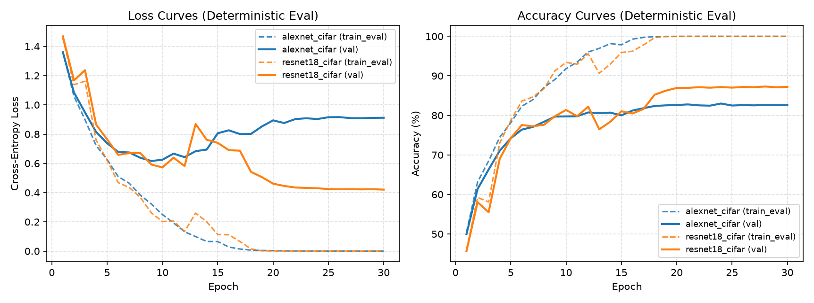

A's original RTX training times were 248.24 s and 684.97 s. Final cost conclusions
use the shared same-device T4 training and Jade inference measurements in Task 6. B's
later T4 evaluation of these same A weights produced 0.8702 for ResNet, one image
above A's original 0.8701. Task 2 preserves the original record; every Task 5
metric uses the later prediction arrays consistently.

## Task 3: capacity and regularization

### Controlled protocol

We used the team's CIFAR-10 pipeline and manually implemented networks. The frozen
stratified split (split seed 2223) divided the official 50,000-image training set
into 45,000 training and 5,000 validation images. We computed normalization
statistics from the training partition alone and reserved the 10,000-image official
test set for final evaluation after fixing the experimental protocol.

For Task 3, we trained AlexNetCIFAR for 30 epochs with seed 42 and batch size 128.
We used SGD with momentum 0.9, an initial learning rate of 0.01 and cosine annealing,
without training augmentation. Each run started from fresh weights and processed
1,350,000 training examples. We selected the checkpoint with the highest validation
accuracy, using lower validation cross-entropy to break ties.

After every epoch, we measured deterministic train_eval and validation metrics with
Dropout disabled. These cross-entropy values exclude the L2 penalty. All six runs
used the same Tesla T4, FP32 and PyTorch 2.14.1+cu130. Training time includes the
validation and train_eval passes after each epoch.

| Configuration | Convolution width | Dropout | SGD weight decay |
|---|---:|---:|---:|
| Reference | 1.0 | 0.5 | 5e-4 |
| Half width | 0.5 | 0.5 | 5e-4 |
| No dropout | 1.0 | 0 | 5e-4 |
| Moderate dropout | 1.0 | 0.25 | 5e-4 |
| No L2 | 1.0 | 0.5 | 0 |
| Weak L2 | 1.0 | 0.5 | 1e-4 |

Each capacity, Dropout or L2 comparison changes one factor from the same reference.
Width scaling changes the channel counts in all five convolutional layers. The FC
hidden dimensions remain 1024 and 512, while the FC input follows the final
feature-map width. Both hidden FC layers apply Dropout after ReLU. SGD weight decay
acts on all trainable parameters, including biases, without an additional L2 term
in the loss.

### Results and interpretation

Results use the checkpoints selected by validation accuracy. Accuracy is expressed
as a percentage. Training time and peak allocated GPU memory follow the shared
training procedure; batch-one latency measures the model forward pass using the
shared benchmark.

| Configuration | Parameters | Best val % (epoch) | Test % | Train s | Peak MiB | Batch-one ms |
|---|---:|---:|---:|---:|---:|---:|
| Reference | 6,976,842 | 83.46 (30) | 82.66 | 358.60 | 314.94 | 0.647 |
| Half width | 3,191,722 | 81.30 (29) | 80.52 | 175.93 | 160.59 | 0.661 |
| No dropout | 6,976,842 | 80.46 (15) | 79.91 | 371.39 | 314.94 | 0.659 |
| Dropout 0.25 | 6,976,842 | 81.38 (21) | 81.45 | 370.44 | 314.94 | 0.639 |
| No L2 | 6,976,842 | 83.14 (24) | 82.19 | 365.82 | 315.07 | 0.727 |
| Weak L2 | 6,976,842 | 83.14 (23) | 81.35 | 367.69 | 314.94 | 0.662 |

Halving convolutional width reduced the parameter count by 54.25%, training time by
50.94% and peak allocated memory by about 49%. This saving cost 2.16 percentage
points of validation accuracy and 2.14 points of test accuracy. Both models reached
approximately 100% deterministic training accuracy, while validation accuracy
plateaued near 81-83%. The smaller model could still fit the training set, so its
lower validation accuracy points to a generalization gap rather than persistent
training underfitting. Batch-one latency was 0.661 versus 0.647 ms: the smaller
parameter count gave no measured single-image speedup on T4.

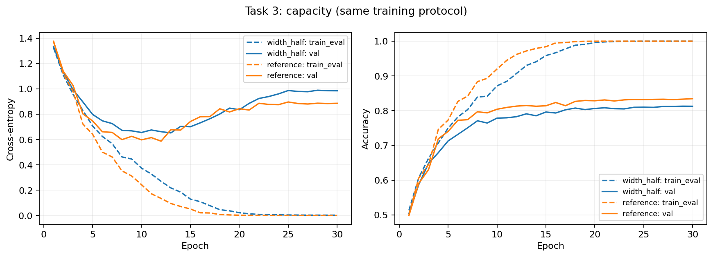

With width and weight decay fixed, Dropout 0, 0.25 and 0.5 gave best validation
accuracies of 80.46%, 81.38% and 83.46%, respectively. The run without Dropout fitted
the training set faster and reached its best validation accuracy at epoch 15.
Validation cross-entropy then rose as training cross-entropy approached zero.
Dropout 0.5 slowed training fit and kept validation cross-entropy lower than the
other settings. All three runs fitted the training set by the end; the widening
train/validation gap supports overfitting, with little evidence of sustained
optimization failure.

Parameter counts were identical and training costs were similar across the Dropout
settings. Since Dropout is disabled during inference, the small latency differences
provide no evidence of a systematic Dropout inference cost. We used the
training-time random unit removal described by
[Srivastava et al. (2014)](https://jmlr.org/papers/v15/srivastava14a.html).

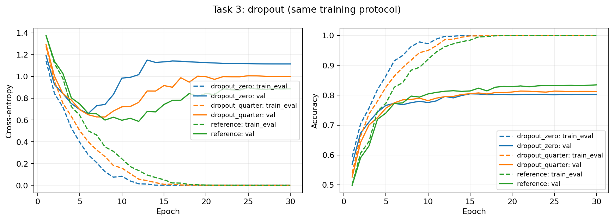

With weight decay 5e-4, best validation accuracy was 83.46%, compared with
83.14% for both 0 and 1e-4. Cross-entropy at the selected checkpoints was 0.887,
1.065 and 0.991, respectively. The stronger tested decay therefore appeared to
reduce confident validation errors more clearly than it improved accuracy. Test
accuracy was 82.66%, 82.19% and 81.35% in the same order, so the accuracy gain was
not monotonic across decay settings. Model size and training cost changed little.
The reference gave the best measured accuracy under this budget; half width gave
the largest training resource saving.

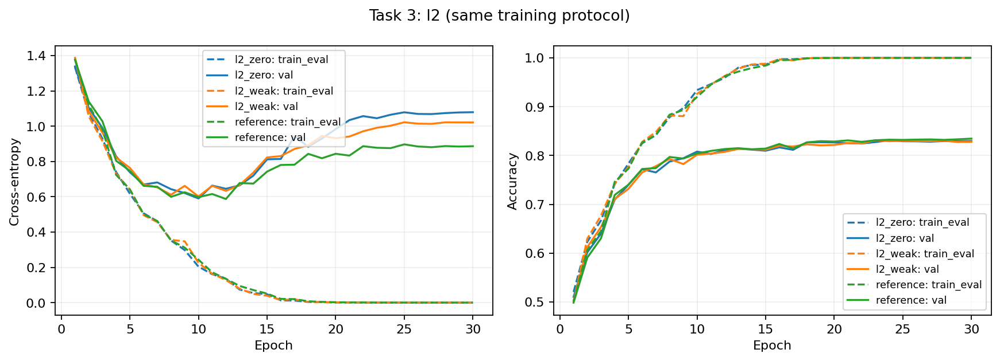

## Task 4: augmentation and robustness

We compared two independently trained seed-42 ResNets from the shared frozen matrix.
Architecture, split, initialization seed, optimizer, schedule, batch size and
30-epoch budget were held fixed. The augmented condition adds a padded random
32 x 32 crop (padding 4) and horizontal flip (probability 0.5) to training only.
These small geometric changes usually preserve object identity; stronger crops
can remove the object and make the label ambiguous.

The evaluation recipe was fixed before evaluation in `corruptions_t4.json`.
Each of the same 10,000 test IDs receives a generator seeded by 2223 + image_id.
Rotation samples an angle uniformly in [-15,+15] degrees with bilinear resampling
and zero fill. Translation samples independent integer offsets in [-3,+3] pixels
with zero fill. Gaussian noise has standard deviation 0.05 and pixels are clamped
to [0,1]. Image IDs and corruption parameters match across models and sessions.

| Condition | No augmentation | Crop + flip | Accuracy difference |
|---|---:|---:|---:|
| Clean | 0.8658 | 0.9308 | +0.0650 |
| Rotation | 0.7680 | 0.8871 | +0.1191 |
| Translation | 0.8014 | 0.9281 | +0.1267 |
| Gaussian noise | 0.7133 | 0.6814 | -0.0319 |
| Mean of the three corruptions | 0.7609 | 0.8322 | +0.0713 |

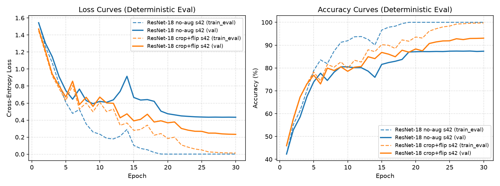

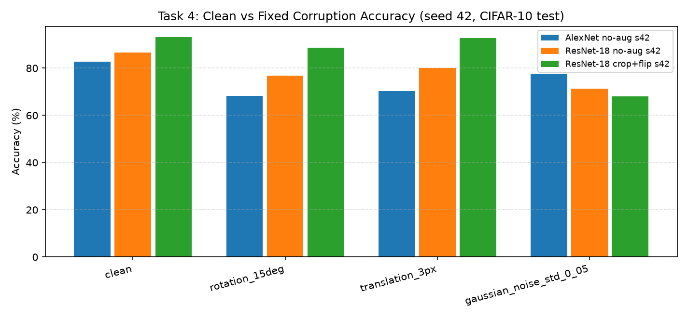

Crop plus flip increased clean and geometric-corruption accuracy, with translation
accuracy almost matching clean accuracy. Noise performance fell by 3.19 points.
Among each model's own clean-correct predictions, rotation made 1,270/8,658
incorrect without augmentation and 593/9,308 with augmentation; translation made
1,032/8,658 and 173/9,308 incorrect. Noise made 1,767/8,658 and 2,658/9,308
incorrect. The resulting noise failure rates are 20.41% and 28.56%.

The augmented model's noise recall was lowest for dog (0.422), airplane (0.474)
and cat (0.543), while frog retained 0.966. Both networks fitted deterministic
training images closely (1.0000 and 0.9972 final train_eval accuracy). Training
fit alone therefore does not explain the noise weakness. Changes in reliance on
texture or coarse shape are possible explanations that this experiment does not
isolate. The notebook includes per-class drops and paired same-ID examples.

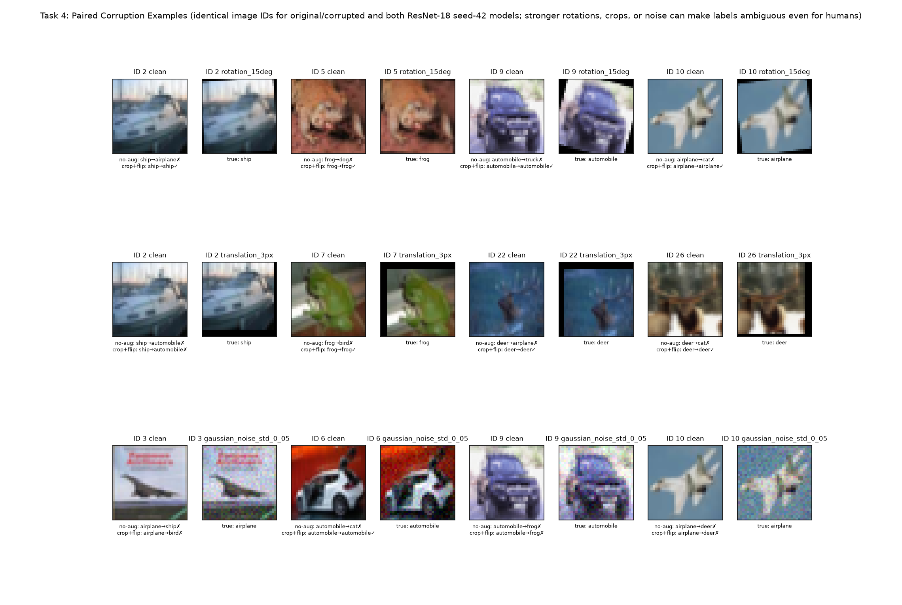

T4 training took 1,855.352 s without augmentation and 1,859.826 s with it, an
additional 4.474 s (0.24%). Both peaked at 802.99 MiB of allocated GPU memory.
On Jade, a full ResNet evaluation pass took approximately 1.418-1.435 s across
conditions. These end-to-end passes include data loading and CPU corruption;
they do not isolate the transform's computation time. A single mild corruption
realization supports conclusions about this suite and severity only.

## Task 5: predictions and adversarial examples

### Evaluation protocol

For prediction analysis, we used the team's frozen `t2_alexnet_cifar_baseline_s42` and
`t2_resnet18_cifar_baseline_s42` weights, trained by Role A at source revision `b1f9a7e`.
We checked each checkpoint's identity, model options and normalization statistics
before loading and recorded its SHA256. We measured accuracy, cross-entropy and
macro F1, with per-class precision/recall/F1 and row-normalized confusion matrices.
Correct and incorrect examples follow ascending image-ID order.

Untargeted FGSM takes a gradient-sign step to increase true-label cross-entropy
through the differentiable normalization step. We defined epsilon in raw [0,1]
pixel coordinates:

\[
x_{adv}=\mathrm{clip}_{[0,1]}(x+\epsilon\,\mathrm{sign}(\nabla_x L)).
\]

We tested budgets of 0, 2/255, 4/255 and 8/255. Every perturbation had to stay within
the valid pixel range and change each pixel channel by at most epsilon, with a
numerical tolerance of 1e-6. The network stayed in evaluation mode with fixed
parameters while input gradients remained enabled. Adversarial accuracy covers all
evaluation images. Attack success rate (ASR) counts the fraction of originally
correct predictions that become incorrect after perturbation. The zero-budget
condition checks that predictions remain unchanged.

The random control adds uniform noise in [-epsilon, epsilon] under the same budget,
using a separate fixed generator for each image ID. We also evaluated the shared frozen
rotation, translation and Gaussian-noise conditions on the same images and
checkpoints. These conditions measure sensitivity to ordinary corruptions, while
FGSM follows a model-dependent direction that increases loss. Their severity
definitions differ from the L-infinity attack budget.

### Results and interpretation

| Frozen baseline | Clean accuracy % | Cross-entropy | Macro F1 | Cat recall % | Dog recall % |
|---|---:|---:|---:|---:|---:|
| AlexNetCIFAR | 82.14 | 0.931 | 0.8205 | 63.2 | 73.9 |
| ResNet18CIFAR | 87.02 | 0.436 | 0.8699 | 74.3 | 79.2 |

ResNet correctly classified 488 more test images than AlexNet and had higher recall
in all ten classes. Cats were the hardest class for both models, followed by several
other animal classes. Automobile recall was 91.5% for AlexNet and 94.0% for ResNet.
The confusion matrices show frequent cat/dog errors in both directions.
Each CIFAR-10 test class contains 1,000 images, so the row fractions are directly
comparable. Full precision/recall/F1 results are in `t5_*_classes.csv`.

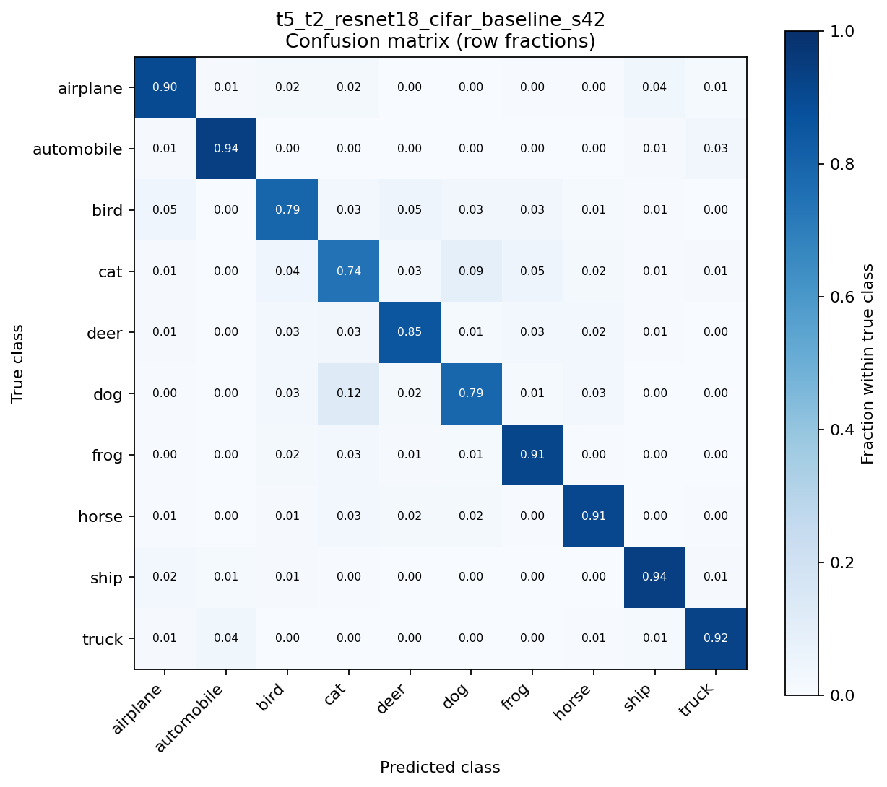

The example grids include clear successes alongside confident mistakes. Both models
predicted deer for test image 24, a dog, with confidence 0.95 for AlexNet and 0.99
for ResNet. For image 35, a bird, AlexNet predicted truck and ResNet predicted ship.
Fine object detail is limited at 32×32 resolution. Clutter, viewpoint and similar
animal shapes are plausible contributors in these examples, although we did not
test those explanations with feature attribution. The grids use the first five
correct and incorrect predictions by ID to avoid manually choosing striking errors.

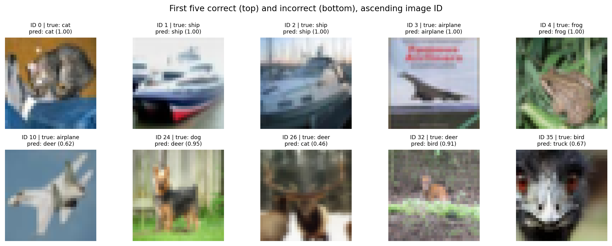

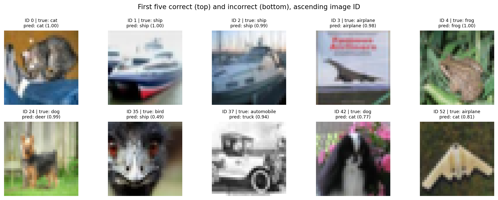

Role A's original training histories show near-perfect final training fit for both
evaluated checkpoints, with a persistent validation gap. AlexNet's validation
cross-entropy rises after its early minimum even as validation accuracy improves
slightly, indicating more confident errors. After fluctuations in the middle
epochs, ResNet reaches a higher validation plateau and lower validation
cross-entropy. Both curves show overfitting despite good final training fit. These
histories belong to the evaluated checkpoints; the new Task 3 reference is a separate
training run.

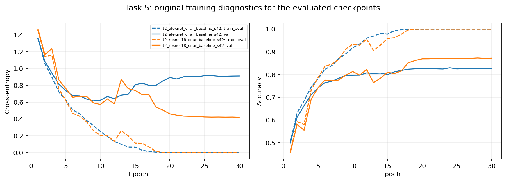

### Optimized perturbations and random controls

All conditions cover the 10,000 official test images. ASR uses the 8,214 originally
correct AlexNet predictions or the 8,702 originally correct ResNet predictions.

| Model | Epsilon | FGSM accuracy % | FGSM ASR % | Random accuracy % | Random ASR % |
|---|---:|---:|---:|---:|---:|
| AlexNet | 0 | 82.14 | 0.00 | 82.14 | 0.00 |
| AlexNet | 2/255 | 46.50 | 43.39 | 82.07 | 0.32 |
| AlexNet | 4/255 | 27.49 | 66.53 | 82.07 | 0.61 |
| AlexNet | 8/255 | 19.01 | 76.86 | 81.67 | 1.67 |
| ResNet | 0 | 87.02 | 0.00 | 87.02 | 0.00 |
| ResNet | 2/255 | 28.34 | 67.43 | 87.03 | 0.47 |
| ResNet | 4/255 | 11.64 | 86.62 | 87.02 | 1.06 |
| ResNet | 8/255 | 4.78 | 94.51 | 86.07 | 2.93 |

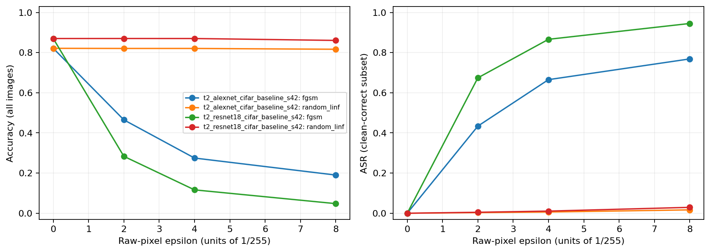

At 8/255, FGSM reduced AlexNet accuracy by 63.13 percentage points and ResNet accuracy
by 82.24 points. Random noise under the same budget caused drops of 0.47 and 0.95
points. Both checkpoints were therefore much more sensitive to the gradient-directed
perturbation. The budget matches the maximum permitted change in each condition.
The perturbation magnitudes still have different distributions: uniform noise
samples the interior of the permitted box, while FGSM usually moves pixels to its
boundary.

ResNet had higher clean accuracy but lower resistance to this untargeted white-box
FGSM attack. That result applies to the two frozen checkpoints and this attack; it
does not establish a general robustness ranking of the architectures. Random-noise
accuracy can stay unchanged while ASR is positive because some initially incorrect
predictions also become correct.

At epsilon 8/255, image 0 changes from cat to dog for AlexNet and from cat to frog
for ResNet. Image 1 changes from ship to automobile for both models. FGSM also fails
on some images: the first retained failures are image 11 for AlexNet and image 23
for ResNet, both of which remain truck. Each row shows the original image, an
amplified perturbation and the actual attacked image. The middle panel displays
`clip(0.5 + 8*delta, 0, 1)` to make the perturbation visible. The input fed to the
model still changes by at most 8/255 per channel.

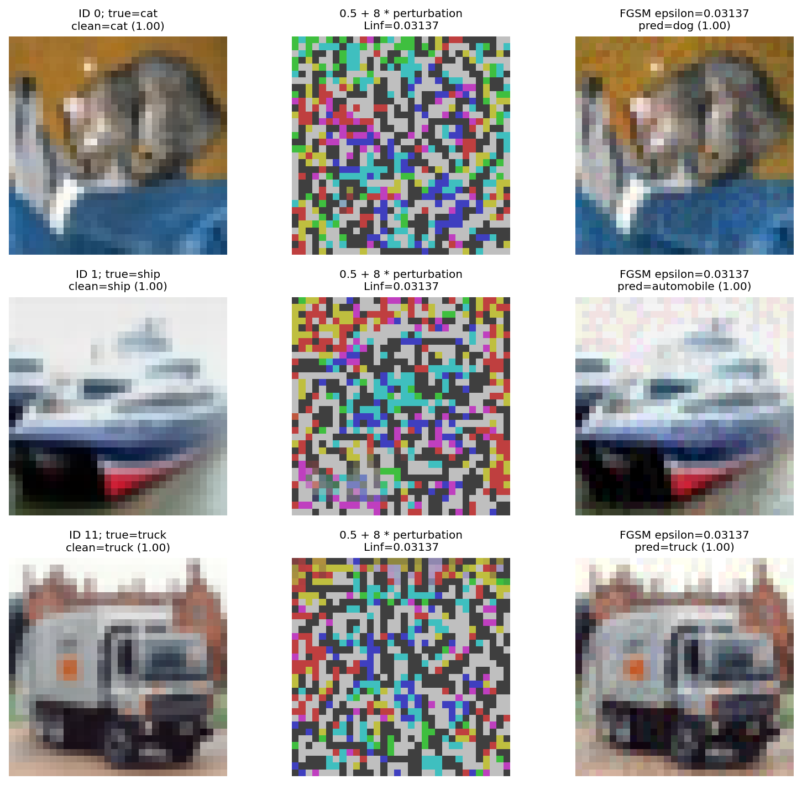

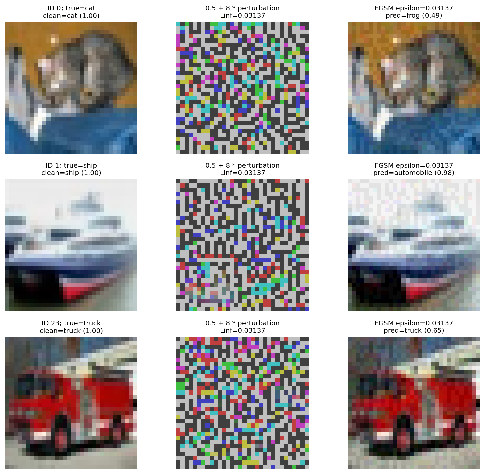

FGSM uses a single gradient-sign step, following
[Goodfellow, Shlens and Szegedy](https://arxiv.org/abs/1412.6572). Remaining correct
after that step does not certify robustness throughout the permitted region.
Iterative attacks with restarts would give a stronger follow-up evaluation. Each
Task 5 JSON also stores the separate rotation, translation and Gaussian-noise
results for the shared frozen settings and the same Role A checkpoints. Those severity
parameters are not equivalent to the L-infinity budget.

### Paired comparison with the frozen corruption suite

We applied the shared exact per-image corruption recipe to the same 10,000 images and Role
A weights used for FGSM. We measured these results directly on those weights;
the shared independently trained checkpoints have separate metrics.

| Evaluation condition | AlexNet accuracy % | ResNet accuracy % |
|---|---:|---:|
| Clean | 82.14 | 87.02 |
| Rotation, maximum 15 degrees | 70.17 | 78.70 |
| Translation, maximum 3 pixels | 70.56 | 81.00 |
| Gaussian noise, standard deviation 0.05 | 77.20 | 73.86 |
| Uniform random L-infinity noise, epsilon 8/255 | 81.67 | 86.07 |
| FGSM, epsilon 8/255 | 19.01 | 4.78 |

ResNet retained higher accuracy under the geometric transformations, whereas AlexNet
retained higher accuracy under Gaussian noise. Their ranking therefore depends on
the corruption family. Gaussian noise has a different magnitude distribution and a
larger standard deviation than the uniform control, so their numerical differences
reflect direction, distribution and severity together. The uniform control
under the same budget is the closer comparison for assessing FGSM's model-dependent
direction.

## Challenge 2: held-out domain generalization

We evaluated the three seed-42 C models on STL-10 after freezing model and
augmentation choices. No STL labels were used for fitting or selection. STL-10's
8,000 test images are 96 x 96 pixels. Removing monkey, which has no CIFAR class,
leaves 7,200 images in nine shared classes. STL's car label maps to CIFAR's
automobile; CIFAR's frog class has no STL counterpart. Bilinear resizing with
antialiasing produces 32 x 32 inputs, followed by CIFAR training normalization.

We report ten-logit accuracy and the fraction predicted as frog, then restrict
argmax to the nine shared logits. The matching CIFAR reference uses its 9,000
shared-class test images. Domain drop equals CIFAR shared-nine accuracy minus
STL masked-nine accuracy; paired IDs are shared across the evaluated models.

| Model (seed 42) | CIFAR 9-way | STL 10-way | Frog leakage | STL 9-way | Domain drop |
|---|---:|---:|---:|---:|---:|
| AlexNet, no augmentation | 0.8310 | 0.6675 | 0.0314 | 0.6825 | 0.1485 |
| ResNet, no augmentation | 0.8683 | 0.7107 | 0.0351 | 0.7267 | 0.1417 |
| ResNet, crop + flip | 0.9339 | 0.8014 | 0.0185 | 0.8108 | 0.1231 |

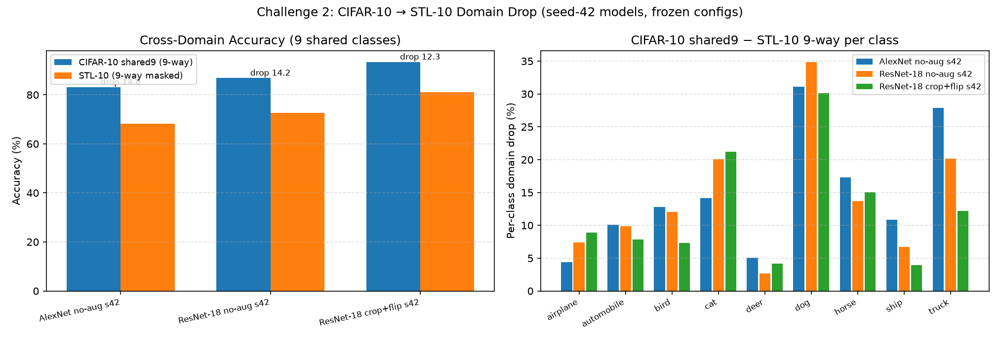

The augmented ResNet transferred best among these three frozen models and had
the smallest domain drop. Its largest per-class drops were dog (0.3013), cat
(0.2118) and horse (0.1507); ship and deer dropped least (0.0395 and 0.0420).
All three models struggled with dog. Reduced texture after resizing and domain
differences are plausible contributors, but the evaluation does not isolate them.
The notebook includes nine-class confusion matrices and deterministic paired
failure examples from the union of the models' error sets. A selected example
can be correct for one model and wrong for another.

## Task 6: cost, sensitivity and recommendation

The final architecture comparison uses the shared five-run matrix. Training was measured
on Tesla T4; all inference measurements below were collected on the Jade RTX 2000
Ada Generation GPU in FP32. Forward benchmarks use resident tensors, 10 warmups,
50 measured forwards, synchronization around timed regions, and batch sizes 1 and
128. They exclude data loading, preprocessing and transfers. Training time includes
validation and deterministic training-set evaluation after each epoch. Peak memory
is allocated CUDA memory in MiB (2^20 bytes), rather than total device reservation.

| Configuration | Parameters | T4 training s | T4 peak MiB | Clean accuracy | Mean corrupt accuracy |
|---|---:|---:|---:|---:|---:|
| AlexNet, no aug, seed 42 | 6.98M | 353.7 | 316.9 | 0.8266 | 0.7207 |
| ResNet, no aug, seed 42 | 11.17M | 1855.4 | 803.0 | 0.8658 | 0.7609 |
| ResNet, crop + flip, seed 42 | 11.17M | 1859.8 | 803.0 | 0.9308 | 0.8322 |
| ResNet, crop + flip, seed 0 | 11.17M | 1858.5 | 803.0 | 0.9279 | 0.8253 |
| ResNet, crop + flip, seed 123 | 11.17M | 1856.0 | 803.0 | 0.9292 | 0.8221 |

| Configuration | Jade batch-1 ms | Jade batch-128 ms/batch | Jade images/s |
|---|---:|---:|---:|
| AlexNet, no aug, seed 42 | 0.309 | 4.50 | 28467 |
| ResNet, no aug, seed 42 | 0.906 | 16.80 | 7621 |
| ResNet, crop + flip, seed 42 | 0.914 | 16.86 | 7593 |
| ResNet, crop + flip, seed 0 | 0.852 | 16.90 | 7575 |
| ResNet, crop + flip, seed 123 | 0.849 | 16.89 | 7577 |

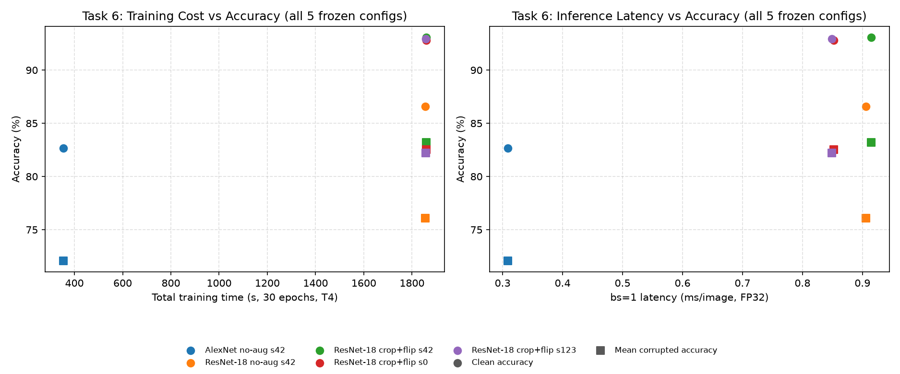

For a roughly 31-minute T4 training budget, we choose the crop-plus-flip ResNet
family on clean accuracy, the fixed CIFAR corruption suite and measured cost.
Relative to the no-augmentation ResNet, it adds 0.24% training time with the same
peak memory, while improving clean and geometric accuracy. STL-10 was held out
from this choice. Gaussian noise remains a weakness: the seed-42 augmented model
scored 0.6814 versus 0.7133 without augmentation.

When single-image latency or throughput dominates, the shared AlexNet offers 0.309 ms
latency, about one third of the augmented ResNet's, and approximately 3.7 times
the batch-128 throughput. Its 354 s training cost is substantially lower, with
10.42 points less clean accuracy and 11.15 points less mean-corruption accuracy.
Within B's separate T4 controlled matrix, halving AlexNet's convolution width
halved training cost and memory, but reduced test accuracy by 2.14 points and
gave no measured batch-one speedup. Smaller parameter count alone is insufficient
evidence of faster inference.

The Task 5 threat model adds a separate constraint to any recommendation. The
frozen A ResNet had strong clean accuracy and 4.78% FGSM accuracy at 8/255; the
frozen A AlexNet had 19.01%. The augmented C ResNet was not attacked here. Its
geometric robustness cannot be used as evidence of adversarial robustness, and
the Task 5 ranking applies only to the attacked checkpoints and single-step FGSM.

### Training duration, random seed and hardware

Validation accuracy at epochs 10, 20 and 30 was 0.8046/0.8236/0.8294 for the shared
AlexNet, 0.8048/0.8712/0.8734 for its no-augmentation ResNet and
0.7854/0.8832/0.9304 for its augmented seed-42 ResNet. Their cumulative T4 times
were about 112/233/354 s, 620/1238/1855 s and 622/1241/1860 s. The augmented
model trailed at epoch 10 and improved substantially later; an early cutoff
would change the conclusion. These are checkpoints along one 30-epoch cosine
schedule, not separately optimized 10- or 20-epoch schedules.

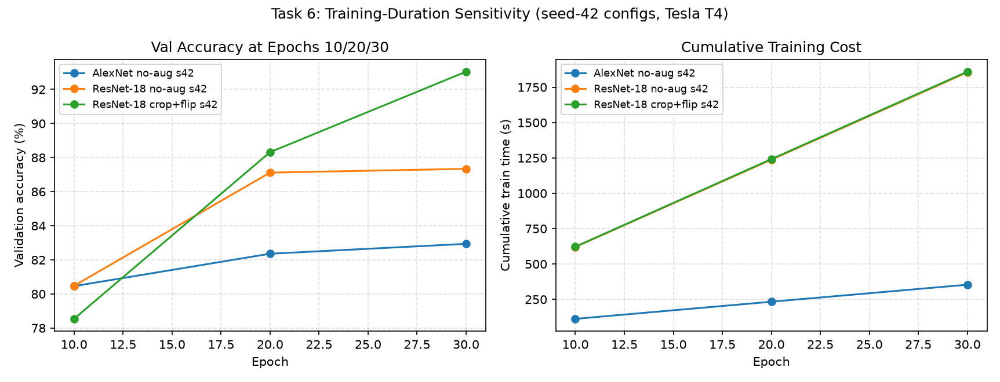

Across augmented ResNet seeds 0, 42 and 123, clean accuracy was 0.9293 +/- 0.0015
(sample standard deviation), mean-corruption accuracy 0.8265 +/- 0.0052 and noise
accuracy 0.6712 +/- 0.0100. Noise varied most, ranging from 0.6615 to 0.6814;
seed 42 had the highest noise accuracy as well as the highest clean and mean
corruption accuracy in these three runs. This supports the family-level result
without establishing an optimal seed. The no-augmentation comparison and all
Task 3 ablations have one seed, so their small differences need replication.

A's RTX and the shared T4 runs have different machines, software and sessions. Their
training-time ratios (about 1.42 for AlexNet and 2.71 for ResNet) describe those
observed environments and do not isolate a GPU effect. T4, Jade and RTX latency
values are not combined into a single speed ranking. In particular, B's T4
forward latency is compared only within its own six-run matrix.

### Most useful next experiments

We would first hold the augmented seed-42 ResNet setup fixed and add training-time
Gaussian noise with standard deviation 0.05 as the only change. Evaluation on the
same frozen suite would test whether noise exposure improves noise accuracy while
preserving clean and geometric performance. That experiment has not been run.
For an adversarial deployment, iterative attacks with restarts on the frozen
recommended checkpoint would be the next evaluation; FGSM failures provide no
robustness certificate. Paired multi-seed repeats of the reference and half-width
AlexNet would clarify whether its resource/accuracy tradeoff is stable.

## Reproduction, validation and references

The executed submission notebook presents these final results and the full source
appendix. `submission_source.zip` supplies all Python modules, tests, configurations,
split IDs, result JSON/CSV files, histories, prediction archives and figures.
`submission_instructions.md` gives display and full-training commands. A's notebook
now displays its saved original artifacts; B and C retain their original executed
training/evaluation notebooks. Data and model weights are kept outside Git and
the submission source archive. Exact weight locations are listed in
`checkpoints_manifest.json` and the shared Drive checkpoints folder.

The integration audit checks the disjoint 45k/5k split, all 13 continuous 30-epoch
histories, validation-selected epochs and 41 paired prediction conditions against
their saved metrics. Fresh CPU shape tracing checks the implemented architecture
against A's recorded profiles. This verifies consistency of the supplied artifacts;
it does not repeat their GPU training or timings. The repository's 34 existing
unit tests also passed. The original C records have an unknown Git commit field;
their source files and recorded outputs are preserved, and the submission's hash
inventory identifies the supplied snapshot without inventing a historical commit.

The course original is the submission standard:
[Lab Assignment 1](https://docs.google.com/document/d/1_WypZO1CwatDjMs1Mm4kfbG2GtAOk8y6/edit).
Implementation and method references are:

- Krizhevsky, Nair and Hinton, [CIFAR-10 dataset](https://www.cs.toronto.edu/~kriz/cifar.html).
- Course [Part A9 / Part B starting notebook](https://colab.research.google.com/drive/1ZsygMpALqkvHszLP_k1WaR8bilzjE3Iz).
- Krizhevsky, Sutskever and Hinton (2012), [ImageNet Classification with Deep Convolutional Neural Networks](https://proceedings.neurips.cc/paper/2012/hash/c399862d3b9d6b76c8436e924a68c45b-Abstract.html).
- He et al. (2016), [Deep Residual Learning for Image Recognition](https://arxiv.org/abs/1512.03385).
- Srivastava et al. (2014), [Dropout: A Simple Way to Prevent Neural Networks from Overfitting](https://jmlr.org/papers/v15/srivastava14a.html).
- Goodfellow, Shlens and Szegedy (2015), [Explaining and Harnessing Adversarial Examples](https://arxiv.org/abs/1412.6572).
- Coates, Ng and Lee (2011), [STL-10 dataset and paper](https://cs.stanford.edu/~acoates/stl10/).
- [PyTorch documentation](https://pytorch.org/docs/stable/index.html), for layers, SGD, scheduling and CUDA measurement APIs.
- Team [ScalableMlLab repository](https://github.com/Mrpooool/ScalableMlLab), frozen experiment contract and accompanying implementation.
