# Accuracy, Robustness, and Cost Tradeoffs of CIFAR-10 Convolutional Networks

**Course:** ID2223 Scalable Machine Learning and Deep Learning, Lab 1  
**Authors:** Muyang Huang, Xinyang Li, Jiahui Chen

## Abstract

We built and evaluated CIFAR-10 adaptations of AlexNet and ResNet-18 across 13 training runs under a shared 45,000/5,000 train/validation split and a 30-epoch budget (1,350,000 training examples per run). Under the baseline setup without augmentation, ResNet-18 beat AlexNet on clean test accuracy (87.01% vs. 82.14%) with less than half the test cross-entropy (0.4357 vs. 0.9310). Controlled AlexNet ablations on a Tesla T4 showed that halving convolutional width cut training time by 50.94% and peak memory by 49.0% at a cost of 2.14 percentage points of test accuracy, while giving no single-image latency speedup. Removing Dropout caused early overfitting at epoch 15 (79.91% test accuracy vs. 82.66% with Dropout 0.5). Adding random crop and horizontal flip to a separate seed-42 ResNet pair raised clean accuracy from 86.58% to 93.08% and geometric-corruption accuracy by roughly 12 percentage points for only 0.24% extra training time, but lowered Gaussian-noise accuracy from 71.33% to 68.14%. On the frozen original baselines, untargeted FGSM at epsilon 8/255 dropped accuracy to 19.01% (AlexNet) and 4.78% (ResNet-18), whereas equal-budget random uniform noise changed accuracy by less than 1 percentage point. On held-out STL-10 (nine shared classes), the augmented ResNet reached 81.08% masked accuracy with the smallest domain drop (12.31 percentage points). Same-device cost benchmarks favor the augmented ResNet when accuracy and geometric robustness matter under a 31-minute T4 training budget, and AlexNet when inference latency or throughput comes first.

---

## 1. Experimental setup and hardware provenance

All experiments share the same PyTorch pipeline, frozen stratified split (`split_indices.json`), train-only channel statistics, and 30-epoch compute budget [1, 4, 10]. We completed Tasks 1-6 and Challenge 2 (held-out cross-domain generalization to STL-10); Challenge 1 was optional and not attempted [9]. Because runs took place across three machines, every numerical cost comparison stays strictly within one hardware group and measurement setup (Table 1).

**Table 1.** Experiment groups and measurement environments.

| Evidence group | Training hardware | Evaluation / inference hardware | Covered tasks |
| :--- | :--- | :--- | :--- |
| Original baselines (A, 2 runs) | RTX 5070 Ti Laptop (PyTorch 2.11+cu128) | RTX 5070 Ti Laptop | Tasks 1-2; frozen weights reused in Task 5 |
| Controlled ablations (B, 6 runs) | Tesla T4 (PyTorch 2.14+cu130) | Tesla T4 | Task 3 capacity, Dropout, L2 |
| Frozen A weights (evaluated by B) | Original A training | Tesla T4 | Task 5 error analysis and FGSM |
| Augmentation & cost matrix (C, 5 runs) | Tesla T4 | Jade RTX 2000 Ada | Tasks 4, 6, Challenge 2 |

---

## 2. Task 1: Data preparation and reproducibility

CIFAR-10 consists of 60,000 `32 x 32` RGB images (`uint8` in `[0, 255]`) evenly distributed across ten classes: airplane, automobile, bird, cat, deer, dog, frog, horse, ship, and truck [1]. We split the 50,000 official training images with stratified sampling (`SPLIT_SEED = 2223`) into 45,000 training images (4,500 per class) and 5,000 validation images (500 per class), leaving the 10,000 official test images (1,000 per class) strictly untouched until all configurations were frozen.

Channel normalization uses training pixels only: mean `[0.4913, 0.4822, 0.4464]` and standard deviation `[0.2470, 0.2434, 0.2615]`. Data loaders return raw `[0, 1]` tensors paired with their original `image_id`, and a differentiable `prepare_inputs` layer applies resizing (when needed) and normalization right before the forward pass. Keeping normalization inside the differentiable graph lets Task 5 enforce FGSM pixel bounds directly in `[0, 1]` space and lets Challenge 2 feed resized STL-10 images through the exact same preprocessing.

A shared seeding helper fixes Python, NumPy, PyTorch, and CUDA RNGs plus seeded DataLoader generators (default `seed = 42`, plus `0` and `123` for seed sensitivity). Fixed seeds keep runs repeatable within a given environment, though GPU kernels and PyTorch versions can still cause tiny boundary differences across devices.

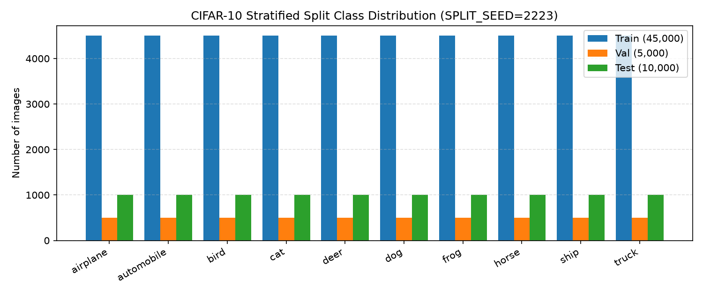

---

## 3. Task 2: Model implementation and baseline comparison

We implemented both networks from scratch with core PyTorch layers (`nn.Conv2d`, `nn.BatchNorm2d`, `nn.ReLU`, `nn.MaxPool2d`, `nn.Linear`), following the course Part A9 CIFAR-10 adaptations without pretrained weights or `torchvision.models` constructors [2, 3, 4, 5].

- **AlexNet (`AlexNetCIFAR`, 6,976,842 parameters):** ImageNet AlexNet uses an `11 x 11` stride-4 first layer that collapses `32 x 32` inputs too early. Our adaptation keeps five convolutions (`64 -> 192 -> 384 -> 256 -> 256` channels) using `3 x 3` stride-1 padding-1 kernels and three `2 x 2` stride-2 max pools (`64x16x16 -> 192x8x8 -> 256x4x4`), followed by `4096 -> 1024 -> 512 -> 10` with ReLU and Dropout 0.5 in both hidden FC layers. Roughly 67.7% of its weights sit in the FC head.
- **ResNet-18 (`ResNet18CIFAR`, 11,173,962 parameters):** Instead of ImageNet's `7 x 7` stride-2 stem and initial max pool, the adapted stem uses one `3 x 3` stride-1 convolution plus BatchNorm and ReLU, keeping full `32 x 32` resolution into Stage 1. Four stages of two `BasicBlock` modules (`64x32x32 -> 128x16x16 -> 256x8x8 -> 512x4x4`) feed global average pooling and a 10-logit linear layer (only 5,130 head parameters). Each block computes `ReLU(F(x) + shortcut(x))`, using a `1 x 1` stride-2 projection plus BatchNorm whenever spatial size or channel width changes. That identity path lets gradients propagate cleanly across 18 layers without vanishing.

For any `Conv2d` layer with kernel size $K$, padding $P$, and stride $S$, output spatial size is $\lfloor(H + 2P - K)/S\rfloor + 1$. Stacking `3 x 3` stride-1 padding-1 convolutions preserves spatial resolution while expanding the receptive field from edges to textures and object parts; pooling or stride-2 stage entries then compress spatial maps while doubling channel capacity. Both networks output raw logits directly to cross-entropy loss.

Both baselines used FP32, batch size 128, SGD with momentum 0.9, weight decay `5e-4`, cosine annealing over 30 epochs, and no training augmentation. Without BatchNorm, AlexNet needed a lower initial learning rate (`0.01`) than ResNet-18 (`0.1`) to train cleanly. Checkpoints were chosen by highest validation accuracy (lower validation CE breaks ties), and every epoch ran a deterministic `train_eval` pass with Dropout off so train and validation curves are directly comparable (Table 2, Fig. 2).

**Table 2.** Task 2 baseline comparison on RTX 5070 Ti Laptop (30 epochs, 1,350,000 samples, no augmentation, seed 42).

| Metric | AlexNetCIFAR | ResNet18CIFAR |
| :--- | :---: | :---: |
| Parameters / checkpoint size | 6,976,842 / 26.62 MB | 11,173,962 / 42.70 MB |
| Initial learning rate | 0.01 | 0.1 |
| Selected epoch | 24 | 28 |
| Best validation acc / CE | 83.00% / 0.9030 | 87.30% / 0.4223 |
| Clean test acc / CE / macro F1 | 82.14% / 0.9310 / 0.8205 | 87.01% / 0.4357 / 0.8698 |
| Final deterministic `train_eval` acc | 100.00% | 100.00% |
| Training time / peak memory (RTX 5070 Ti) | 248.24 s / 316.07 MiB | 684.97 s / 834.62 MiB |

ResNet-18 beat AlexNet by 4.87 percentage points on test accuracy and cut test cross-entropy by more than half (0.4357 vs. 0.9310). Both models memorized the training set (100% deterministic training accuracy) and left a clear generalization gap. AlexNet's validation cross-entropy climbed even while its validation accuracy crept up, a sign of increasingly overconfident mistakes. Later re-evaluation of the exact same frozen ResNet weights on Tesla T4 (Task 5) gave 87.02% (one test image different); Task 2 keeps the original RTX record, and Task 5 uses the T4 prediction arrays throughout.

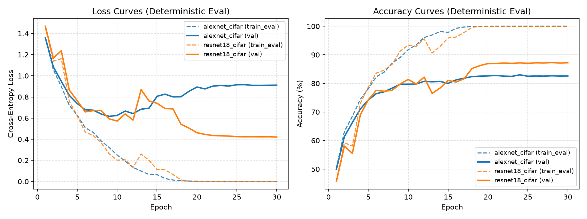

---

## 4. Task 3: Capacity and regularization

We ran six controlled 30-epoch `AlexNetCIFAR` experiments from scratch on a single Tesla T4 (FP32, batch size 128, SGD momentum 0.9, `lr = 0.01`, cosine schedule, no augmentation, `seed = 42`), changing one factor at a time from the shared reference (`width_mult = 1.0`, `dropout = 0.5`, `weight_decay = 5e-4`). Width scaling changes all five convolutional stages while keeping FC hidden sizes fixed at 1024 and 512. Dropout [6] sits after ReLU in both hidden FC layers; SGD weight decay acts on all trainable parameters. Table 3 and Figs. 3-5 summarize the outcomes.

**Table 3.** Controlled AlexNet ablations on Tesla T4 (30 epochs, validation-selected checkpoints).

| Configuration | Width | Dropout | Weight decay | Params | Best val % (ep) | Val CE | Test % | Train s | Peak MiB | Batch-1 ms |
| :--- | :---: | :---: | :---: | ---: | :---: | :---: | :---: | :---: | :---: | :---: |
| Reference | 1.0 | 0.50 | 5e-4 | 6,976,842 | 83.46 (30) | 0.887 | 82.66 | 358.60 | 314.94 | 0.647 |
| Half width | 0.5 | 0.50 | 5e-4 | 3,191,722 | 81.30 (29) | 0.986 | 80.52 | 175.93 | 160.59 | 0.661 |
| No dropout | 1.0 | 0.00 | 5e-4 | 6,976,842 | 80.46 (15) | 1.134 | 79.91 | 371.39 | 314.94 | 0.659 |
| Dropout 0.25 | 1.0 | 0.25 | 5e-4 | 6,976,842 | 81.38 (21) | 0.973 | 81.45 | 370.44 | 314.94 | 0.639 |
| No L2 | 1.0 | 0.50 | 0 | 6,976,842 | 83.14 (24) | 1.065 | 82.19 | 365.82 | 315.07 | 0.727 |
| Weak L2 | 1.0 | 0.50 | 1e-4 | 6,976,842 | 83.14 (23) | 0.991 | 81.35 | 367.69 | 314.94 | 0.662 |

- **Capacity (width):** Halving convolutional width cut parameters by 54.25%, training time by 50.94%, and peak memory by 49.0%, at a cost of 2.14 percentage points on test accuracy (80.52% vs. 82.66%). Both models still hit ~100% deterministic training accuracy (99.99% for half width), so the gap reflects weaker generalization rather than underfitting. Single-image latency on T4 did not improve (0.661 vs. 0.647 ms) because small batch-1 GPU calls are launch-bound rather than compute-bound.
- **Dropout:** Increasing Dropout from `0 -> 0.25 -> 0.50` raised validation accuracy monotonically (`80.46% -> 81.38% -> 83.46%`) and test accuracy (`79.91% -> 81.45% -> 82.66%`). Without Dropout, the network fit the training set rapidly and peaked early at epoch 15, after which validation cross-entropy climbed sharply to 1.134. Dropout 0.5 slowed training fit, kept validation loss much lower, and added negligible training cost and zero inference penalty.
- **L2 regularization:** Weight decay had a stronger effect on calibration than on raw accuracy. Validation accuracy moved only slightly (`83.14%` at `0` and `1e-4` vs. `83.46%` at `5e-4`), and test accuracy was non-monotonic (`82.19%`, `81.35%`, `82.66%`), yet validation cross-entropy dropped steadily from `1.065` (`0`) to `0.991` (`1e-4`) and `0.887` (`5e-4`).

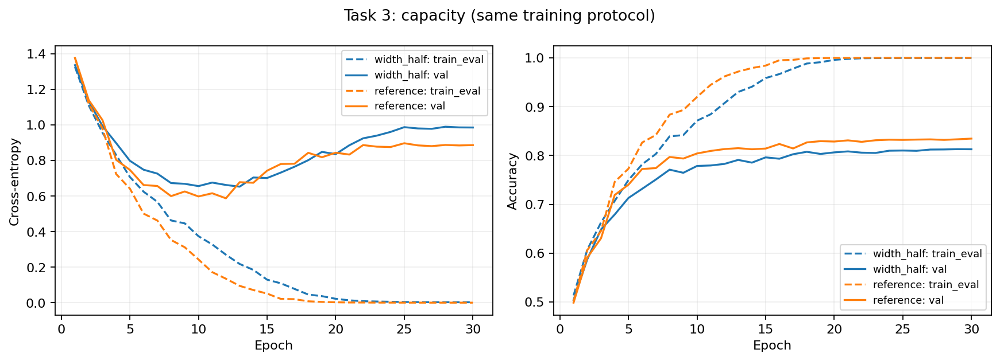
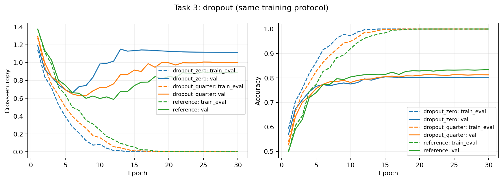
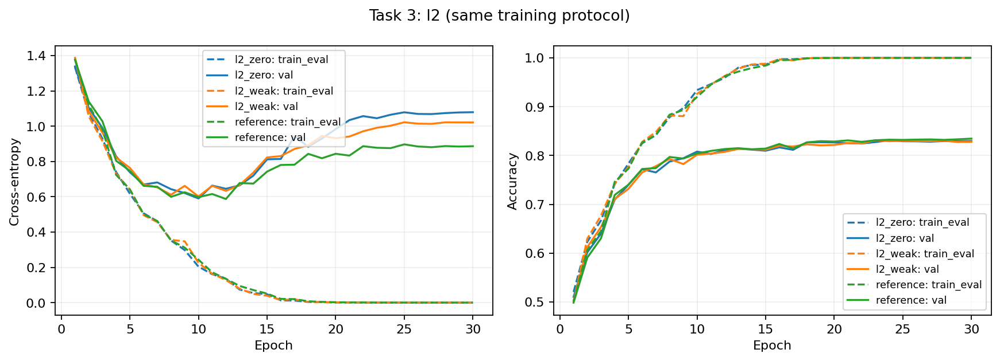

---

## 5. Task 4: Data augmentation and corruption robustness

We compared two independently trained seed-42 ResNet-18 models on Tesla T4 with identical architecture, optimizer, schedule, and 30-epoch budget. The augmented model adds padded random `32 x 32` crops (padding 4) and random horizontal flips (`p = 0.5`) during training only. These mild geometric transforms preserve object labels on CIFAR-10; heavier crops or large rotations can crop out the foreground or flip upright classes such as airplanes and ships into ambiguous views.

To evaluate robustness fairly across all models, we froze `corruptions_t4.json` before testing. Each of the 10,000 test images uses a deterministic generator seeded by `2223 + image_id` for three corruptions: uniform rotation in `[-15, +15]` degrees (bilinear resampling, zero fill), independent integer translation in `[-3, +3]` pixels (zero fill), and additive Gaussian noise (`std = 0.05`, clamped to `[0, 1]`).

**Table 4.** Paired seed-42 ResNet-18 test accuracy with and without training augmentation (10,000 identical test IDs).

| Condition | No augmentation | Crop + flip | Delta (pp) |
| :--- | :---: | :---: | :---: |
| Clean | 86.58% | 93.08% | +6.50 |
| Rotation (max 15 deg) | 76.80% | 88.71% | +11.91 |
| Translation (max 3 px) | 80.14% | 92.81% | +12.67 |
| Gaussian noise (std 0.05) | 71.33% | 68.14% | -3.19 |
| Mean of 3 corruptions | 76.09% | 83.22% | +7.13 |

Crop plus flip delivered a large jump on clean images (+6.50 pp) and nearly erased the translation penalty (92.81% vs. 93.08% clean). Among clean-correct predictions, rotation flipped 1,270/8,658 images without augmentation versus 593/9,308 with augmentation; translation flipped 1,032/8,658 versus 173/9,308. Gaussian noise went the other way: accuracy dropped by 3.19 pp, and clean-correct failure rate rose from 20.41% (1,767/8,658) to 28.56% (2,658/9,308). Under noise, the augmented ResNet struggled most on dog (0.422 recall), airplane (0.474), and cat (0.543), while frog stayed at 0.966. Geometric augmentation therefore improves geometric invariance without improving pixel-noise robustness.

The extra compute cost was tiny: T4 training time went from `1,855.35 s` to `1,859.83 s` (+4.47 s, or +0.24%) with identical peak GPU memory (`802.99 MiB`). Full 10,000-image evaluation passes on Jade took `1.42-1.44 s` per condition.

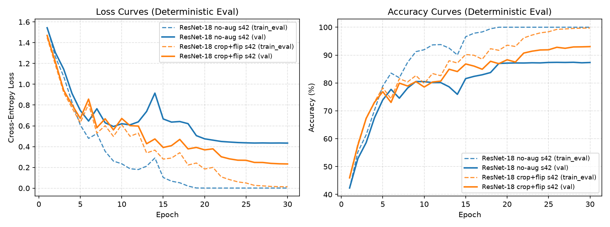
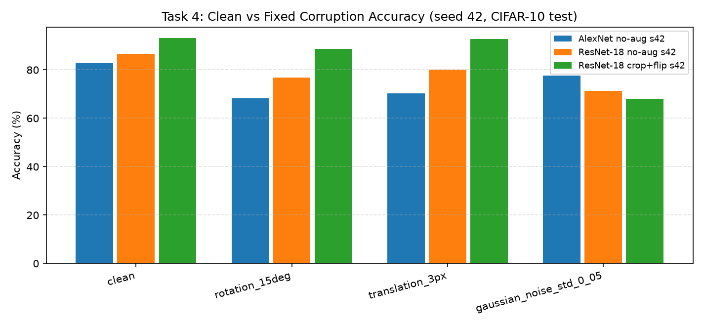
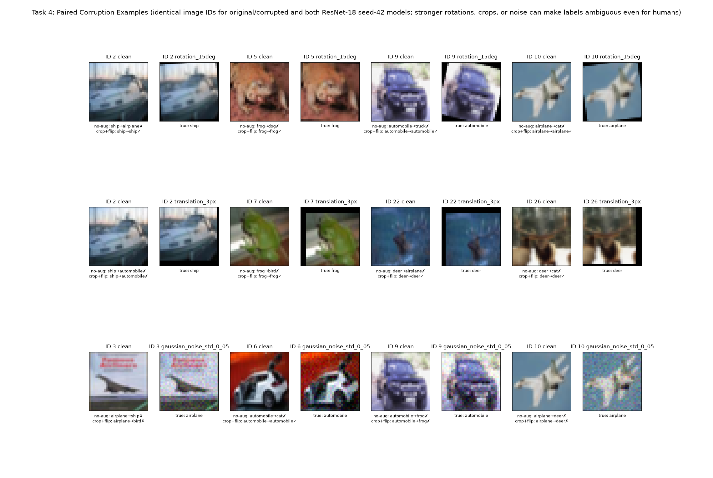

---

## 6. Task 5: Prediction analysis and adversarial examples

Using the two frozen Role A baseline checkpoints on Tesla T4, we inspected full 10,000-image test metrics, confusion matrices, deterministic prediction grids (first five correct and incorrect test IDs), and untargeted white-box FGSM attacks [7].

**Error patterns:** ResNet-18 correctly classified 488 more test images than AlexNet (87.02% vs. 82.14%; macro F1 0.8699 vs. 0.8205; CE 0.436 vs. 0.931) and beat AlexNet in every class. Both models struggled most on fine-grained animals, especially cat (63.2% recall on AlexNet, 74.3% on ResNet) and dog (73.9% vs. 79.2%), with frequent bidirectional cat/dog confusion, while vehicles such as automobile reached 91.5% and 94.0%. Confident errors appear even on ResNet: test image 24 (dog) was called deer with confidence 0.95 (AlexNet) and 0.99 (ResNet), and image 35 (bird) was called truck and ship. Low `32 x 32` detail, background clutter, and pose likely contribute, though we did not run feature attribution to isolate them.

**FGSM vs. random perturbations:** We generated untargeted FGSM inputs in raw `[0, 1]` pixel space through the differentiable normalization layer:

$$x_{\text{adv}} = \operatorname{clip}_{[0,1]}\!\left(x + \epsilon\,\operatorname{sign}(\nabla_x L)\right)$$

We tested $\epsilon \in \{0, 2/255, 4/255, 8/255\}$ (verified within `1e-6` tolerance) and compared against an equal-budget random control adding uniform noise in $[-\epsilon, +\epsilon]$ per pixel (seeded per `image_id`). Attack success rate (ASR) is the fraction of originally clean-correct predictions (8,214 for AlexNet; 8,702 for ResNet) that flip to a wrong label.

**Table 5.** FGSM vs. equal-budget uniform random noise and shared corruptions on the two frozen Role A baselines (10,000 test images).

| Condition | AlexNet acc % (ASR %) | ResNet-18 acc % (ASR %) |
| :--- | :---: | :---: |
| Clean ($\epsilon = 0$) | 82.14 (0.00) | 87.02 (0.00) |
| FGSM $\epsilon = 2/255$ | 46.50 (43.39) | 28.34 (67.43) |
| FGSM $\epsilon = 4/255$ | 27.49 (66.53) | 11.64 (86.62) |
| FGSM $\epsilon = 8/255$ | 19.01 (76.86) | 4.78 (94.51) |
| Random uniform $L_\infty$, $\epsilon = 2/255$ | 82.07 (0.32) | 87.03 (0.47) |
| Random uniform $L_\infty$, $\epsilon = 4/255$ | 82.07 (0.61) | 87.02 (1.06) |
| Random uniform $L_\infty$, $\epsilon = 8/255$ | 81.67 (1.67) | 86.07 (2.93) |
| Rotation (max 15 deg, `corruptions_t4`) | 70.17 | 78.70 |
| Translation (max 3 px, `corruptions_t4`) | 70.56 | 81.00 |
| Gaussian noise (std 0.05, `corruptions_t4`) | 77.20 | 73.86 |

At $\epsilon = 8/255$, FGSM cut AlexNet accuracy by 63.13 pp and ResNet accuracy by 82.24 pp, whereas equal-budget random noise caused drops of only 0.47 pp and 0.95 pp. Gradient-aligned steps push pixels toward the $L_\infty$ box corners along high-loss directions, whereas random noise samples the box interior without targeting the decision boundary. Notably, the cleaner ResNet checkpoint was far more vulnerable to single-step FGSM (94.51% ASR vs. 76.86% on AlexNet) and slightly weaker under Gaussian noise (73.86% vs. 77.20%), showing that clean accuracy does not guarantee adversarial or noise robustness. At `8/255`, image 0 (cat) flipped to dog on AlexNet and frog on ResNet; image 1 (ship) flipped to automobile on both. FGSM also failed on some samples: the first retained failures were image 11 (AlexNet) and image 23 (ResNet), both staying truck. Because FGSM takes only one gradient step, surviving images are not certified robust; multi-step PGD with restarts would give a tighter test.

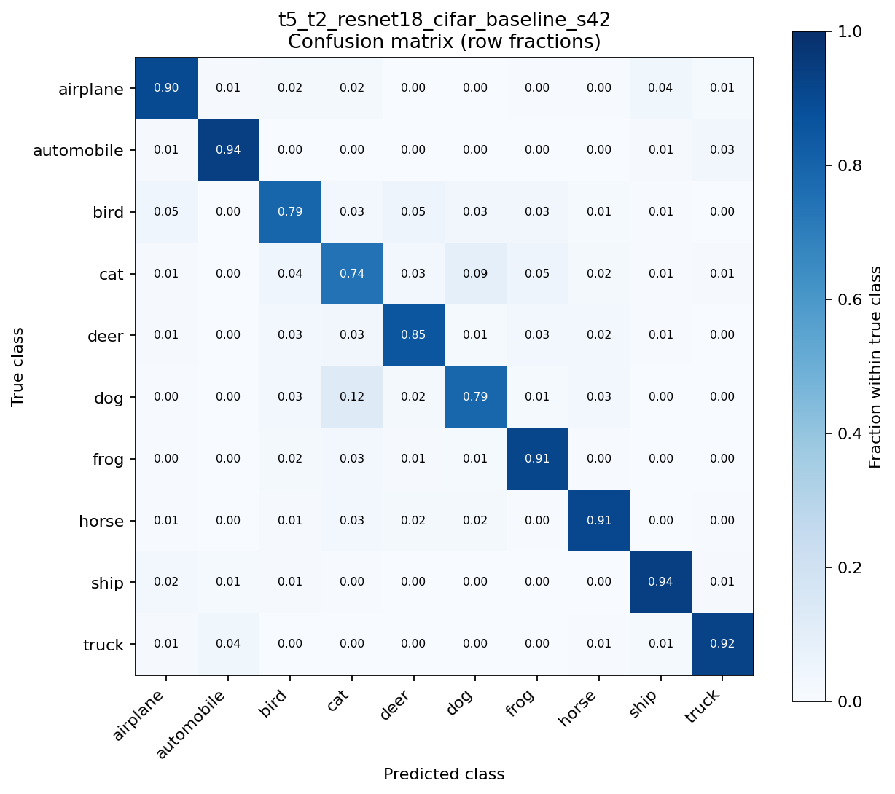
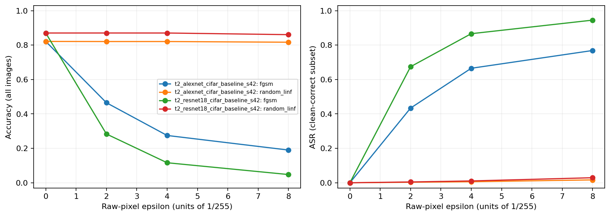
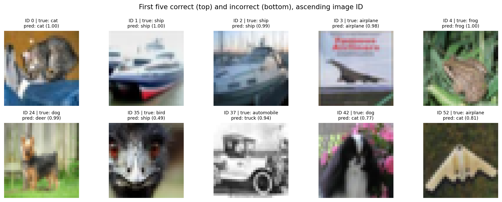
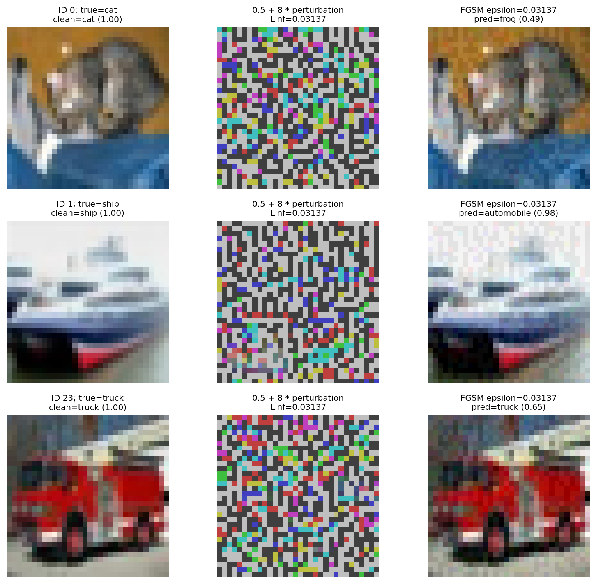

---

## 7. Challenge 2: Held-out domain generalization (CIFAR-10 to STL-10)

After locking all model and augmentation choices, we evaluated the three frozen seed-42 Role C models on the STL-10 test split [8]. No STL-10 images or labels entered training, tuning, or normalization. STL-10 contains 8,000 `96 x 96` photographic images from ImageNet across ten classes. Dropping `monkey` (absent in CIFAR-10) leaves 7,200 images across nine shared classes, mapping STL `car` to CIFAR `automobile`; CIFAR `frog` has no STL counterpart. Each image was downsampled to `32 x 32` with bilinear antialiasing and normalized using CIFAR-10 training statistics.

We report unmodified 10-class accuracy, frog leakage (fraction wrongly predicted as `frog`), and 9-class masked accuracy (excluding the frog logit), compared against each model's accuracy on the matching 9,000 shared-class CIFAR-10 test images (Table 6).

**Table 6.** Held-out CIFAR-10 to STL-10 cross-domain evaluation (seed 42, 7,200 STL-10 images vs. 9,000 CIFAR-10 shared-class images).

| Frozen model (seed 42) | CIFAR 9-way | STL 10-way | Frog leakage | STL 9-way | Domain drop (pp) |
| :--- | :---: | :---: | :---: | :---: | :---: |
| AlexNet, no aug | 83.10% | 66.75% | 3.14% | 68.25% | 14.85 |
| ResNet-18, no aug | 86.83% | 71.07% | 3.51% | 72.67% | 14.17 |
| ResNet-18, crop + flip | 93.39% | 80.14% | 1.85% | 81.08% | 12.31 |

Every model lost 12 to 15 percentage points across the domain shift, but the augmented ResNet transferred best (81.08% masked 9-way accuracy, lowest frog leakage at 1.85%, and smallest drop at 12.31 pp). Even so, fine-grained animals degraded sharply: on the augmented ResNet, dog dropped 30.13 pp, cat 21.18 pp, and horse 15.07 pp, whereas ship (3.95 pp) and deer (4.20 pp) held up well. Downsampling `96 x 96` natural photos to `32 x 32` removes fine fur and facial cues while background clutter increases compared to tightly framed CIFAR-10 objects.

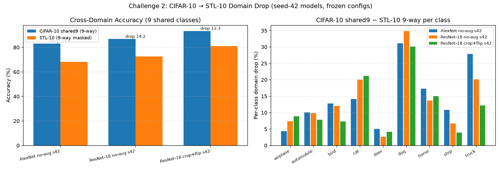
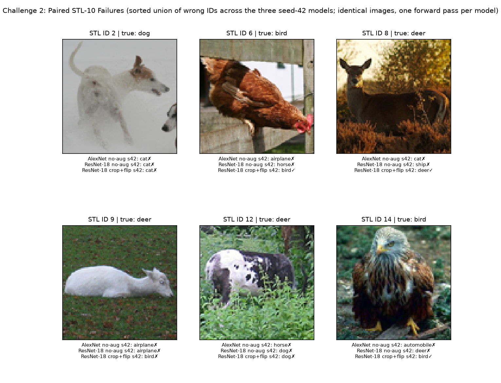

---

## 8. Task 6: Cost benchmarks, sensitivity, and recommendation

Table 7 brings together the five-run Role C matrix: all training costs come from Tesla T4 (30 epochs, FP32, including per-epoch validation and `train_eval`), and all forward-pass inference benchmarks come from Jade RTX 2000 Ada (FP32, resident tensors, 10 warmups, 50 synchronized runs at `bs = 1` and `bs = 128`).

**Table 7.** Unified T4 training cost and Jade RTX 2000 Ada FP32 inference performance.

| Configuration | Params | T4 train s | T4 peak MiB | Clean acc | Mean corrupt acc | Jade bs=1 ms | Jade bs=128 ms | Jade imgs/s |
| :--- | :---: | :---: | :---: | :---: | :---: | :---: | :---: | :---: |
| AlexNet, no aug, s42 | 6.98M | 353.7 | 316.9 | 82.66% | 72.07% | 0.309 | 4.50 | 28,467 |
| ResNet, no aug, s42 | 11.17M | 1,855.4 | 803.0 | 86.58% | 76.09% | 0.906 | 16.80 | 7,621 |
| ResNet, crop+flip, s42 | 11.17M | 1,859.8 | 803.0 | 93.08% | 83.22% | 0.914 | 16.86 | 7,593 |
| ResNet, crop+flip, s0 | 11.17M | 1,858.5 | 803.0 | 92.79% | 82.53% | 0.852 | 16.90 | 7,575 |
| ResNet, crop+flip, s123 | 11.17M | 1,856.0 | 803.0 | 92.92% | 82.21% | 0.849 | 16.89 | 7,577 |

**Recommendation:** Under our 31-minute T4 training budget, we recommend **ResNet-18 with random crop and horizontal flip**. Adding augmentation costs only 0.24% extra training time and zero extra GPU memory or inference latency, while gaining +6.50 pp clean accuracy and +7.13 pp mean corruption accuracy over unaugmented ResNet (and transferring best on held-out STL-10). Two caveats limit this choice: Gaussian noise remains weak (68.14%), and we did not run FGSM on the augmented checkpoint, so geometric robustness must not be treated as adversarial defense. When strict inference speed dominates, AlexNet delivers roughly 3x lower single-image latency (`0.309` vs. `0.914 ms`), 3.7x higher batch-128 throughput (`28,467` vs. `7,593 imgs/s`), and 5.2x faster training (`354` vs. `1,860 s`), trading away 10.42 pp of clean accuracy and 11.15 pp of mean corruption accuracy.

**Sensitivity to duration, seed, and hardware:**
- *Training duration:* Along the 30-epoch cosine schedule, validation accuracy at epochs 10 / 20 / 30 was `80.46 / 82.36 / 82.94%` for AlexNet (`112 / 233 / 354 s`), `80.48 / 87.12 / 87.34%` for unaugmented ResNet (`620 / 1,238 / 1,855 s`), and `78.54 / 88.32 / 93.04%` for augmented ResNet (`622 / 1,241 / 1,860 s`). Stopping at epoch 10 would have misranked the augmented ResNet last because augmentation delays early fitting before paying off strongly after epoch 15.
- *Random seed:* Across augmented ResNet seeds `{0, 42, 123}`, clean accuracy stayed tight (`92.93 +/- 0.15%`, sample std) and mean corruption accuracy varied modestly (`82.65 +/- 0.52%`), while Gaussian noise showed the widest spread (`67.12 +/- 1.00%`, range `66.15-68.14%`, with seed 42 highest). Single-seed Task 3 and no-augmentation differences of under 1 pp should be treated cautiously until repeated.
- *Hardware:* Role A's RTX 5070 Ti trained AlexNet 1.42x faster and ResNet 2.71x faster than T4, reflecting differences in GPU generation, PyTorch/CUDA stack, and host I/O. Within Task 3 on T4, halving AlexNet width cut training time in half without reducing batch-1 latency (`0.661` vs. `0.647 ms`), proving that parameter counts alone do not predict inference speed.

**Most useful next experiments:** First, add training-time Gaussian noise (`std = 0.05`) to the exact seed-42 crop-and-flip ResNet setup as a single controlled change to test whether noise robustness improves without hurting clean or geometric accuracy. Second, evaluate the recommended augmented ResNet under multi-step PGD with random restarts rather than single-step FGSM. Third, run multi-seed repeats of the half-width vs. full-width AlexNet pair to confirm whether the 2.14 pp tradeoff is stable.

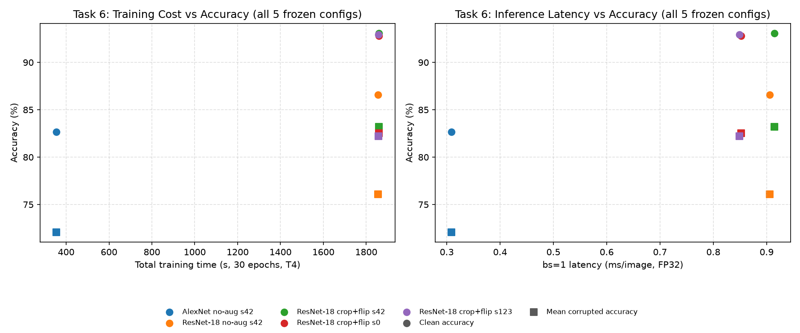
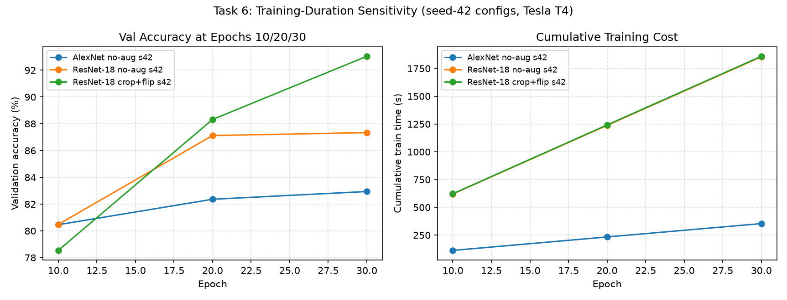

---

## 9. Reproducibility

The executed notebook `lab1/notebooks/lab1_submission.ipynb` verifies the disjoint 45k/5k split, checks all 13 continuous 30-epoch histories and 41 paired prediction conditions against saved JSON/CSV logs, traces model shapes on CPU, displays all figures, and embeds the full Python source appendix (all 34 unit tests in `lab1/tests/` pass). Datasets and `.pt` checkpoints stay outside Git and are indexed by exact path and SHA256 in `lab1/results/checkpoints_manifest.json` and `lab1/submission_inventory.json`.

## References

1. Krizhevsky, A., Nair, V. & Hinton, G. CIFAR-10 and CIFAR-100 datasets. https://www.cs.toronto.edu/~kriz/cifar.html
2. Krizhevsky, A., Sutskever, I. & Hinton, G. E. ImageNet classification with deep convolutional neural networks. *NeurIPS* 25 (2012).
3. He, K., Zhang, X., Ren, S. & Sun, J. Deep residual learning for image recognition. *CVPR*, 770-778 (2016).
4. PyTorch contributors. PyTorch documentation. https://pytorch.org/docs/stable/index.html
5. ID2223 Lab Session 2: Part A9 and Part B. https://colab.research.google.com/drive/1ZsygMpALqkvHszLP_k1WaR8bilzjE3Iz
6. Srivastava, N. et al. Dropout: a simple way to prevent neural networks from overfitting. *JMLR* 15, 1929-1958 (2014).
7. Goodfellow, I. J., Shlens, J. & Szegedy, C. Explaining and harnessing adversarial examples. *ICLR* (2015).
8. Coates, A., Ng, A. & Lee, H. An analysis of single-layer networks in unsupervised feature learning. *AISTATS* 15, 215-223 (2011).
9. Lab Assignment 1: Building and Evaluating Convolutional Neural Networks. Course assignment specification.
10. ScalableMlLab contributors. Lab 1 implementation and frozen experiment contract. https://github.com/Mrpooool/ScalableMlLab
