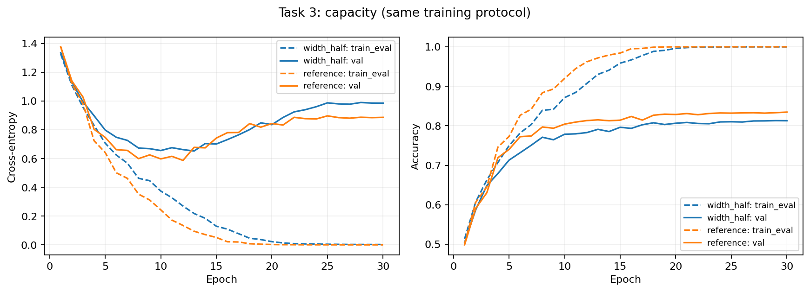
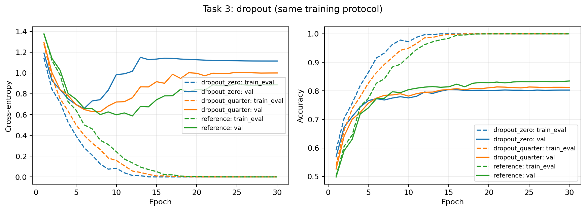
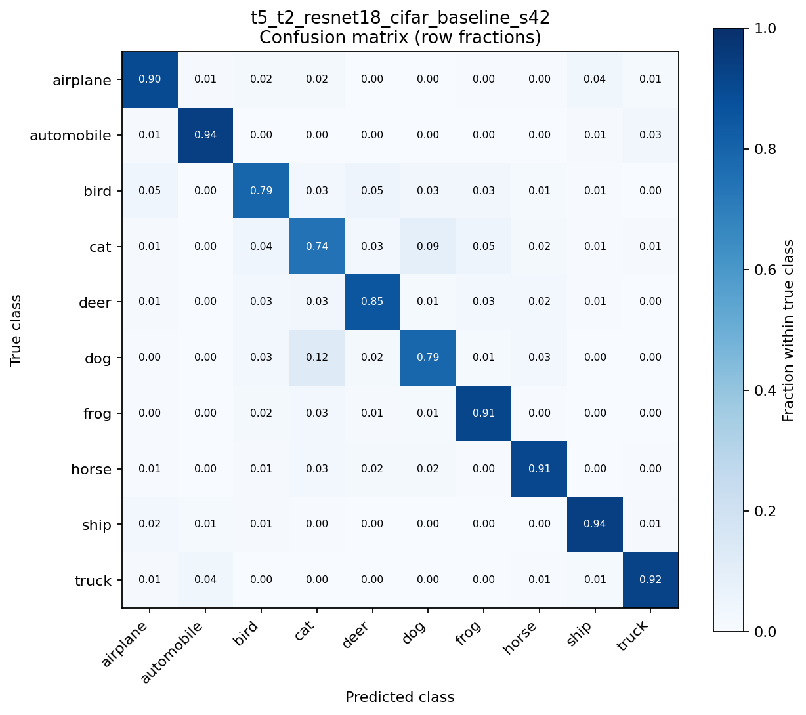
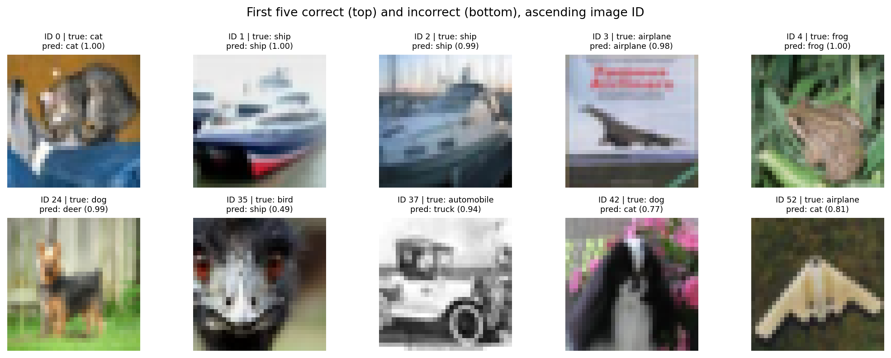
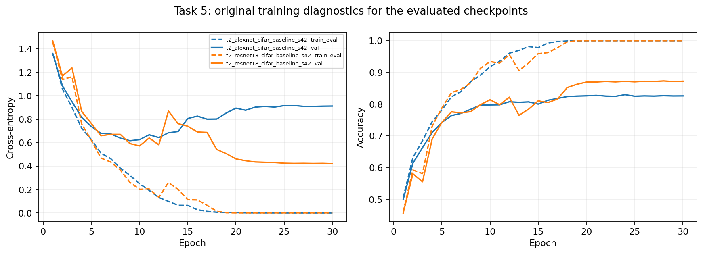
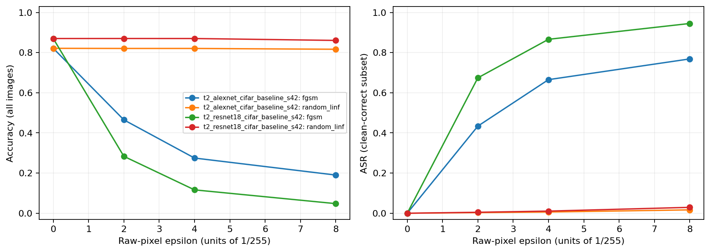
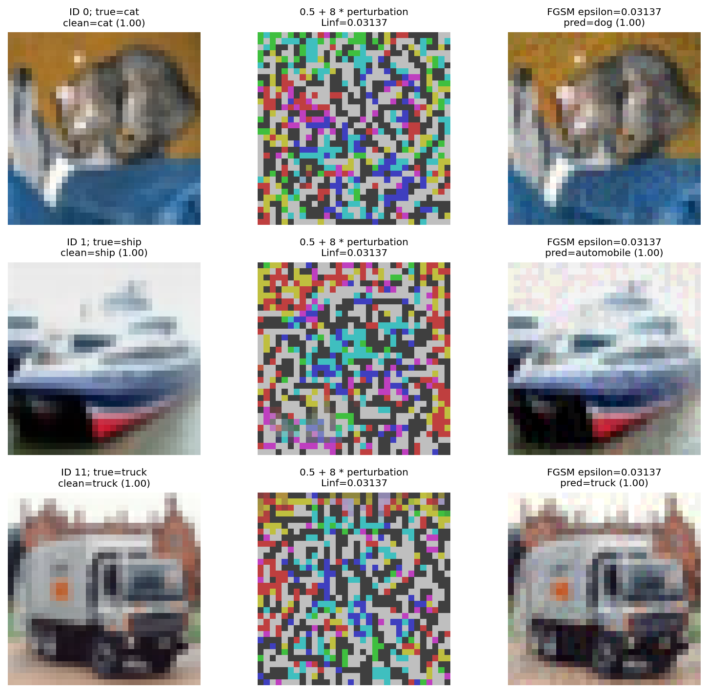
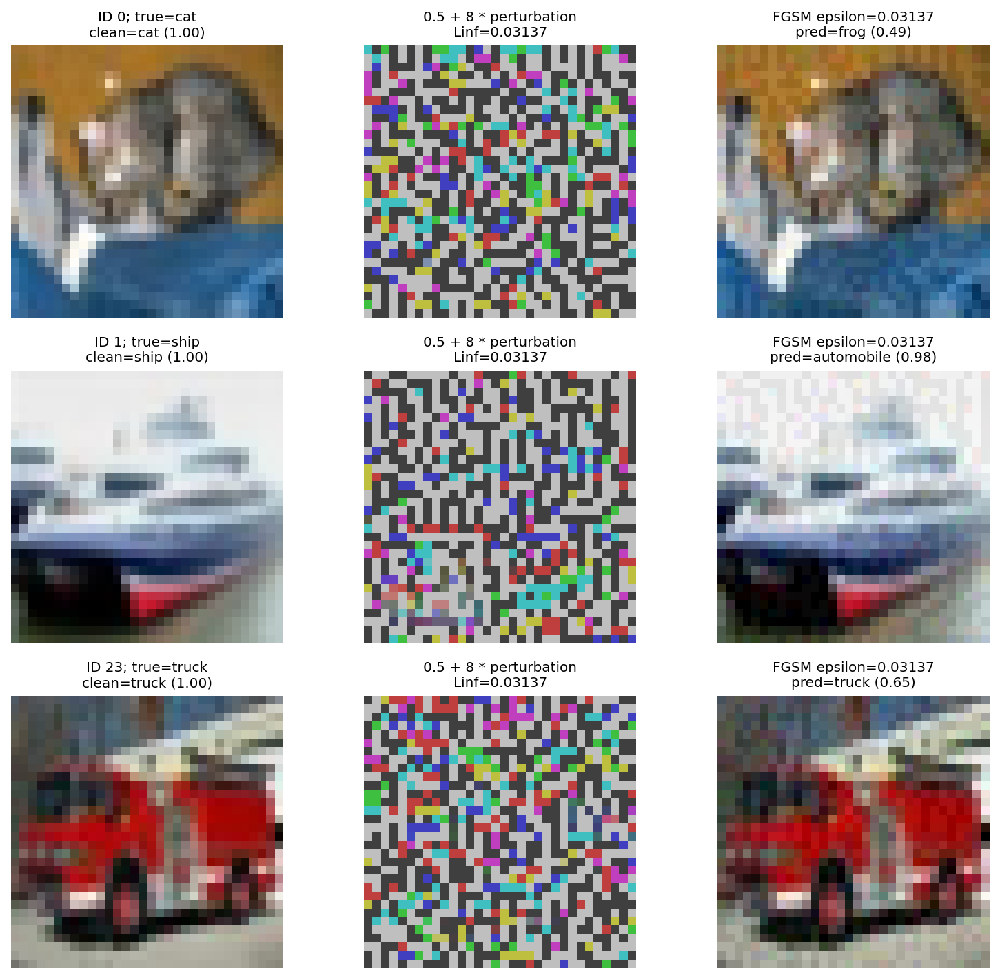

# Tasks 3 and 5: Capacity, Regularization and Adversarial Analysis

Six complete training runs and both full-test prediction analyses were executed on
Tesla T4. This chapter supplies Role B's contribution to the combined Tasks 1–6 report.

## Experimental protocol

We reused the team's CIFAR-10 pipeline and manually implemented networks. The official
50,000-image training set was partitioned into 45,000 training and 5,000 validation
images using the frozen stratified split (split seed 2223). Normalization used statistics
computed exclusively on the training partition. The 10,000-image official test set
was reserved for evaluation of the fixed experimental protocol.

Task 3 used AlexNetCIFAR with seed 42, batch size 128, 30 epochs, SGD with momentum 0.9,
initial learning rate 0.01, cosine annealing, and no training augmentation. Each run
processed 1,350,000 training examples and started from a fresh initialization. The
checkpoint with highest validation accuracy was retained, breaking ties by lower
validation cross-entropy. Deterministic train_eval and validation metrics were measured
after every epoch with Dropout disabled. Their cross-entropy values exclude the L2
penalty. All six training runs used the same Tesla T4, FP32 and PyTorch 2.14.1+cu130.
Training time includes the per-epoch validation and train_eval passes.

| Configuration | Convolution width | Dropout | SGD weight decay |
|---|---:|---:|---:|
| Reference | 1.0 | 0.5 | 5e-4 |
| Half width | 0.5 | 0.5 | 5e-4 |
| No dropout | 1.0 | 0 | 5e-4 |
| Moderate dropout | 1.0 | 0.25 | 5e-4 |
| No L2 | 1.0 | 0.5 | 0 |
| Weak L2 | 1.0 | 0.5 | 1e-4 |

Capacity, Dropout and L2 comparisons each share the reference and change one factor.
Width scaling changes all five convolutional channel counts; the FC hidden dimensions
remain 1024 and 512, with the FC input adapted to the final feature-map width. Dropout
is applied after the ReLU of both hidden FC layers. SGD weight decay is applied to all
trainable parameters, including biases; no additional L2 term is added to the loss.

## Task 3 results and interpretation

The following results use validation-selected checkpoints. Accuracy is reported as
a percentage. Time and peak allocated GPU memory use the shared training procedure;
latency is the shared benchmark's batch-one model-forward measurement.

| Configuration | Parameters | Best val % (epoch) | Test % | Train s | Peak MiB | Batch-one ms |
|---|---:|---:|---:|---:|---:|---:|
| Reference | 6,976,842 | 83.46 (30) | 82.66 | 358.60 | 314.94 | 0.647 |
| Half width | 3,191,722 | 81.30 (29) | 80.52 | 175.93 | 160.59 | 0.661 |
| No dropout | 6,976,842 | 80.46 (15) | 79.91 | 371.39 | 314.94 | 0.659 |
| Dropout 0.25 | 6,976,842 | 81.38 (21) | 81.45 | 370.44 | 314.94 | 0.639 |
| No L2 | 6,976,842 | 83.14 (24) | 82.19 | 365.82 | 315.07 | 0.727 |
| Weak L2 | 6,976,842 | 83.14 (23) | 81.35 | 367.69 | 314.94 | 0.662 |

**Capacity.** Halving convolutional width reduced parameters by 54.25%, measured
training time by 50.94%, and peak allocated memory by about 49%. Validation accuracy
fell by 2.16 percentage points and test accuracy by 2.14 points. Both models reached
approximately 100% deterministic training accuracy, while validation accuracy
plateaued near 81–83%. The smaller model therefore still had sufficient capacity to
fit the training set. Its main observed tradeoff was lower generalization accuracy
with lower training cost, rather than persistent training underfitting. Batch-one
latency was 0.661 versus 0.647 ms, so parameter reduction did not produce a measured
single-image speedup on T4.

**Dropout.** With width and weight decay fixed, increasing Dropout from 0 to 0.25 to
0.5 raised best validation accuracy from 80.46% to 81.38% to 83.46%. Without Dropout,
training fit improved faster, the best validation checkpoint occurred at epoch 15,
and validation cross-entropy subsequently rose while training cross-entropy
approached zero. Dropout 0.5 delayed training fit and reduced validation
cross-entropy relative to the other settings. The widening train/validation gap
supports overfitting as the main problem. All three runs fitted the training set by
the end, providing no evidence of sustained optimization failure. Their parameter
counts were identical and measured training costs were similar. Dropout is disabled
during inference, so the small latency differences are not evidence of a systematic
Dropout inference cost. The method follows the training-time random unit removal
described by [Srivastava et al. (2014)](https://jmlr.org/papers/v15/srivastava14a.html).

**L2 regularization.** Weight decay 5e-4 yielded 83.46% best validation accuracy,
compared with 83.14% for both 0 and 1e-4. Its validation cross-entropy at the selected
checkpoint was 0.887, versus 1.065 and 0.991. This suggests that the stronger tested
decay reduced confident validation errors more clearly than it changed accuracy.
The test results were 82.66%, 82.19%, and 81.35%, respectively; the weak-decay result
shows that accuracy did not improve monotonically across these settings. Training
cost and model size changed little. Under this fixed budget, the reference offered
the strongest measured accuracy, while half width offered the clearest training
resource saving.

## Task 5 evaluation protocol

Prediction analysis uses the team's frozen `t2_alexnet_cifar_baseline_s42` and
`t2_resnet18_cifar_baseline_s42` weights, trained by Role A at source revision `b1f9a7e`.
Each checkpoint's identity, model options and normalization statistics are checked
before loading, and its SHA256 is recorded. Accuracy, cross-entropy, macro F1,
per-class precision/recall/F1 and row-normalized confusion matrices are reported.
Correct and incorrect examples are selected in ascending image-ID order.

Untargeted FGSM maximizes the true-label cross-entropy through the differentiable
normalization step, with epsilon defined in raw [0,1] pixel coordinates:

\[
x_{adv}=\mathrm{clip}_{[0,1]}(x+\epsilon\,\mathrm{sign}(\nabla_x L)).
\]

The budgets are 0, 2/255, 4/255 and 8/255. Every evaluated perturbation is checked for
valid pixel range and maximum absolute change at most epsilon (numerical tolerance
1e-6). The network remains in evaluation mode while input gradients are enabled;
model parameters are held fixed. Adversarial accuracy uses all evaluation images.
Attack success rate (ASR) is the fraction of originally correct predictions that
become incorrect after perturbation. The zero-budget condition checks identity.

An equal-budget random control uses uniform noise in [-epsilon, epsilon], with a
separate fixed generator for each image ID. C's frozen rotation, translation and
Gaussian-noise conditions are also evaluated on the same images and checkpoints.
These corruptions have different severity definitions from the L-infinity attacks.
The comparison separates sensitivity to ordinary image changes from sensitivity to
a model-dependent loss-increasing direction.

## Task 5 results and interpretation

| Frozen baseline | Clean accuracy % | Cross-entropy | Macro F1 | Cat recall % | Dog recall % |
|---|---:|---:|---:|---:|---:|
| AlexNetCIFAR | 82.14 | 0.931 | 0.8205 | 63.2 | 73.9 |
| ResNet18CIFAR | 87.02 | 0.436 | 0.8699 | 74.3 | 79.2 |

ResNet correctly classified 488 more test images. Its recall was higher in all ten
classes. Cats were the most difficult class for both models, followed by several
other animal classes, while automobile recall was 91.5% and 94.0%. The confusion
matrices show substantial cat/dog confusion in both directions. The CIFAR-10 classes
each contain 1,000 test images, making these row fractions directly comparable.
The full precision/recall/F1 tables are supplied in `t5_*_classes.csv`.

The fixed example grids show both clear successes and confident mistakes. For
example, test image 24 is a dog predicted as deer by both models, with confidence
0.95 for AlexNet and 0.99 for ResNet. Image 35 is a bird predicted as truck by AlexNet
and ship by ResNet. At 32×32 resolution, fine object detail is sparse; clutter,
viewpoint and shared animal shapes are plausible contributors visible in the
grids. These observations describe the examples and do not establish a causal
feature explanation. The grids include the first five correct and incorrect
predictions rather than a manually selected set of dramatic failures.

The original baseline histories show near-perfect final training fit for both
models, with a persistent validation gap. AlexNet validation cross-entropy rises
after its early minimum even while validation accuracy improves slightly, indicating
increasingly confident errors. ResNet reaches a higher validation plateau and lower
validation cross-entropy after its middle-epoch fluctuations. Both curves support
overfitting; neither ends with poor training fit. These are Role A's actual training
histories for the checkpoints evaluated here, rather than histories of the new
Task 3 reference run.

### Optimized perturbations and random controls

Every row below evaluates all 10,000 official test images. ASR uses 8,214 originally
correct AlexNet predictions or 8,702 originally correct ResNet predictions.

| Model | Epsilon | FGSM accuracy % | FGSM ASR % | Random accuracy % | Random ASR % |
|---|---:|---:|---:|---:|---:|
| AlexNet | 0 | 82.14 | 0.00 | 82.14 | 0.00 |
| AlexNet | 2/255 | 46.50 | 43.39 | 82.07 | 0.32 |
| AlexNet | 4/255 | 27.49 | 66.53 | 82.07 | 0.61 |
| AlexNet | 8/255 | 19.01 | 76.86 | 81.67 | 1.67 |
| ResNet | 0 | 87.02 | 0.00 | 87.02 | 0.00 |
| ResNet | 2/255 | 28.34 | 67.43 | 87.03 | 0.47 |
| ResNet | 4/255 | 11.64 | 86.62 | 87.02 | 1.06 |
| ResNet | 8/255 | 4.78 | 94.51 | 86.07 | 2.93 |

At 8/255, FGSM reduced AlexNet accuracy by 63.13 percentage points and ResNet by
82.24 points. Equal-budget random noise reduced accuracy by only 0.47 and 0.95
points. The difference demonstrates strong sensitivity to a gradient-directed
perturbation under the stated L-infinity budget. Uniform random noise samples the
interior of the permitted box, whereas FGSM usually moves pixels to its boundary;
the control matches the maximum permitted change, rather than the complete
distribution of perturbation magnitudes.

ResNet's higher clean accuracy therefore did not translate into stronger resistance
to this attack. This is a comparison of the two frozen checkpoints under untargeted
white-box FGSM, rather than a general robustness ranking of their architectures.
Random accuracy can remain unchanged while ASR is positive because some originally
incorrect images also become correct.

At epsilon 8/255, image 0 changes from cat to dog for AlexNet and from cat to frog
for ResNet. Image 1 changes from ship to automobile for both. The first retained
failure is image 11 for AlexNet and image 23 for ResNet: each remains truck. The
panels show the original image, an amplified perturbation, and the actual attacked
image. The middle panel uses `clip(0.5 + 8*delta, 0, 1)` solely to make the perturbation
visible; the real input change remains at most 8/255 per channel.

FGSM is a single gradient-sign step following
[Goodfellow, Shlens and Szegedy](https://arxiv.org/abs/1412.6572). A failed FGSM attempt
shows failure of this particular step; it does not certify that an image is robust
within the permitted region. Iterative attacks with restarts would provide a
stronger follow-up evaluation. Rotation, translation and Gaussian-noise results
are retained separately in each Task 5 JSON using C's frozen corruption settings
and the same Role A checkpoints; their severity parameters are not equivalent to
the L-infinity budget.

### Paired comparison with C's frozen corruptions

These measurements reuse C's exact per-image corruption recipe on the same 10,000
images and the same Role A weights used for FGSM. They do not reuse metrics from
C's independently trained checkpoints.

| Evaluation condition | AlexNet accuracy % | ResNet accuracy % |
|---|---:|---:|
| Clean | 82.14 | 87.02 |
| Rotation, maximum 15 degrees | 70.17 | 78.70 |
| Translation, maximum 3 pixels | 70.56 | 81.00 |
| Gaussian noise, standard deviation 0.05 | 77.20 | 73.86 |
| Uniform random L-infinity noise, epsilon 8/255 | 81.67 | 86.07 |
| FGSM, epsilon 8/255 | 19.01 | 4.78 |

ResNet retained higher accuracy under the tested geometric transformations, while
AlexNet retained higher accuracy under Gaussian noise. Thus ordinary-corruption
performance also depends on the corruption family. The Gaussian condition has a
different magnitude distribution and a larger standard deviation than the uniform
control, so their numerical differences combine direction, distribution and
severity effects. The same-budget uniform control provides the closer comparison
for interpreting FGSM's model-dependent direction.

## Implications for the combined report

For this AlexNet training budget, the full-width reference with Dropout 0.5 and
weight decay 5e-4 gave the highest measured validation and test accuracy. The
half-width model is a practical option when training time or memory is the binding
constraint, with an observed 2.14-point test accuracy cost. The frozen ResNet is the
stronger clean classifier in Task 5, but its much lower FGSM accuracy shows why a
deployment recommendation must state its threat model. Role C can combine these
measurements with augmentation and cost results in Task 6, comparing timing only
when hardware and benchmark procedures match.

All comparisons use one seed and a 30-epoch schedule. Small accuracy differences,
especially the L2 results, require repeated seeds to assess stability. The selected
checkpoint maximizes validation accuracy, which can differ from the epoch minimizing
cross-entropy. Inference measurements use 10 warmups and 50 measured forwards on
resident tensors and exclude preprocessing, transfers and data loading. Repeated
timing sessions would be needed to interpret small latency differences. A useful
next experiment is a paired multi-seed repeat of the reference and half-width
configurations, followed by iterative adversarial evaluation of the fixed models.

## Validation and reproducibility

The repository's 34 unit tests, including five Task 5/control-design tests, passed
locally. The five B tests and a separate 128-training/64-validation-image smoke test
also passed in Colab T4 before formal training. Source/config hashes, checkpoint
hashes, original image IDs, environment metadata and complete learning histories
are retained alongside the measurements. Source code is supplied in Python modules;
the executed notebook calls these modules and displays their outputs.

The execution used the repository base revision
`d2eec8535fe105becf4ba035ce5fb762c57a687c` plus the new Role B source snapshot.
The base revision alone does not contain the new modules: per-file SHA256 values
in every result identify the exact executed source. A's checkpoint source revision
is separately recorded as `b1f9a7e`. The T4 reevaluation of A's ResNet produced
87.02% clean accuracy, compared with 87.01% in its earlier result file; the current
prediction arrays and metrics consistently use 87.02%.

## Dataset, implementation and method references

- Krizhevsky, Nair and Hinton, [CIFAR-10 dataset](https://www.cs.toronto.edu/~kriz/cifar.html).
- Krizhevsky, Sutskever and Hinton (2012), [ImageNet Classification with Deep Convolutional Neural Networks](https://proceedings.neurips.cc/paper/2012/hash/c399862d3b9d6b76c8436e924a68c45b-Abstract.html).
- He et al. (2016), [Deep Residual Learning for Image Recognition](https://arxiv.org/abs/1512.03385).
- Srivastava et al. (2014), [Dropout: A Simple Way to Prevent Neural Networks from Overfitting](https://jmlr.org/papers/v15/srivastava14a.html).
- Goodfellow, Shlens and Szegedy (2015), [Explaining and Harnessing Adversarial Examples](https://arxiv.org/abs/1412.6572).
- Team implementation and frozen protocol: [ScalableMlLab](https://github.com/Mrpooool/ScalableMlLab), `lab1/src/`, `lab1/docs/experiment_contract.md`; Role B additions are supplied with this chapter.
