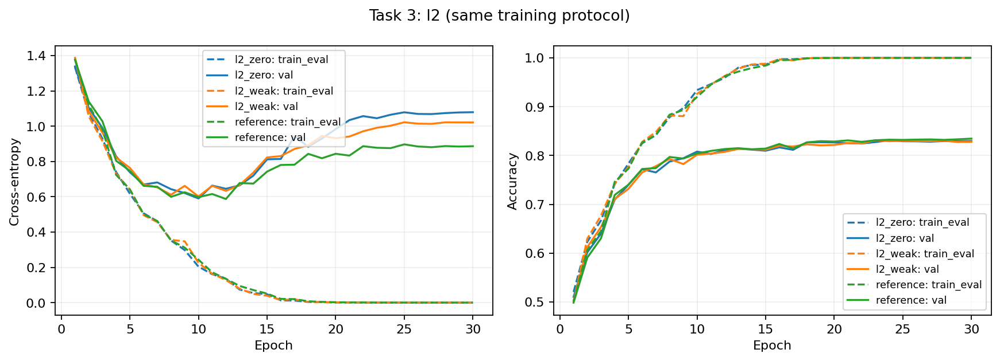
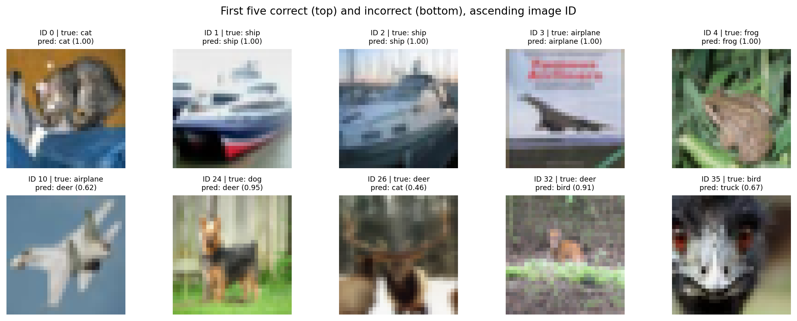

# Tasks 3 and 5: capacity, regularization and adversarial analysis

We completed six training runs and both full-test prediction analyses on Tesla T4
for Role B's contribution to the Tasks 1-6 report.

## Experimental protocol

We used the team's CIFAR-10 pipeline and manually implemented networks. The frozen
stratified split (split seed 2223) divided the official 50,000-image training set
into 45,000 training and 5,000 validation images. We computed normalization
statistics from the training partition alone and reserved the 10,000-image official
test set for final evaluation after fixing the experimental protocol.

For Task 3, we trained AlexNetCIFAR for 30 epochs with seed 42 and batch size 128.
We used SGD with momentum 0.9, an initial learning rate of 0.01 and cosine annealing,
without training augmentation. Each run started from fresh weights and processed
1,350,000 training examples. We selected the checkpoint with the highest validation
accuracy, using lower validation cross-entropy to break ties.

After every epoch, we measured deterministic train_eval and validation metrics with
Dropout disabled. These cross-entropy values exclude the L2 penalty. All six runs
used the same Tesla T4, FP32 and PyTorch 2.14.1+cu130. Training time includes the
validation and train_eval passes after each epoch.

| Configuration | Convolution width | Dropout | SGD weight decay |
|---|---:|---:|---:|
| Reference | 1.0 | 0.5 | 5e-4 |
| Half width | 0.5 | 0.5 | 5e-4 |
| No dropout | 1.0 | 0 | 5e-4 |
| Moderate dropout | 1.0 | 0.25 | 5e-4 |
| No L2 | 1.0 | 0.5 | 0 |
| Weak L2 | 1.0 | 0.5 | 1e-4 |

Each capacity, Dropout or L2 comparison changes one factor from the same reference.
Width scaling changes the channel counts in all five convolutional layers. The FC
hidden dimensions remain 1024 and 512, while the FC input follows the final
feature-map width. Both hidden FC layers apply Dropout after ReLU. SGD weight decay
acts on all trainable parameters, including biases, without an additional L2 term
in the loss.

## Task 3 results and interpretation

Results use the checkpoints selected by validation accuracy. Accuracy is expressed
as a percentage. Training time and peak allocated GPU memory follow the shared
training procedure; batch-one latency measures the model forward pass using the
shared benchmark.

| Configuration | Parameters | Best val % (epoch) | Test % | Train s | Peak MiB | Batch-one ms |
|---|---:|---:|---:|---:|---:|---:|
| Reference | 6,976,842 | 83.46 (30) | 82.66 | 358.60 | 314.94 | 0.647 |
| Half width | 3,191,722 | 81.30 (29) | 80.52 | 175.93 | 160.59 | 0.661 |
| No dropout | 6,976,842 | 80.46 (15) | 79.91 | 371.39 | 314.94 | 0.659 |
| Dropout 0.25 | 6,976,842 | 81.38 (21) | 81.45 | 370.44 | 314.94 | 0.639 |
| No L2 | 6,976,842 | 83.14 (24) | 82.19 | 365.82 | 315.07 | 0.727 |
| Weak L2 | 6,976,842 | 83.14 (23) | 81.35 | 367.69 | 314.94 | 0.662 |

Halving convolutional width reduced the parameter count by 54.25%, training time by
50.94% and peak allocated memory by about 49%. This saving cost 2.16 percentage
points of validation accuracy and 2.14 points of test accuracy. Both models reached
approximately 100% deterministic training accuracy, while validation accuracy
plateaued near 81-83%. The smaller model could still fit the training set, so its
lower validation accuracy points to a generalization gap rather than persistent
training underfitting. Batch-one latency was 0.661 versus 0.647 ms: the smaller
parameter count gave no measured single-image speedup on T4.

With width and weight decay fixed, Dropout 0, 0.25 and 0.5 gave best validation
accuracies of 80.46%, 81.38% and 83.46%, respectively. The run without Dropout fitted
the training set faster and reached its best validation accuracy at epoch 15.
Validation cross-entropy then rose as training cross-entropy approached zero.
Dropout 0.5 slowed training fit and kept validation cross-entropy lower than the
other settings. All three runs fitted the training set by the end; the widening
train/validation gap supports overfitting, with little evidence of sustained
optimization failure.

Parameter counts were identical and training costs were similar across the Dropout
settings. Since Dropout is disabled during inference, the small latency differences
provide no evidence of a systematic Dropout inference cost. We used the
training-time random unit removal described by
[Srivastava et al. (2014)](https://jmlr.org/papers/v15/srivastava14a.html).

With weight decay 5e-4, best validation accuracy was 83.46%, compared with
83.14% for both 0 and 1e-4. Cross-entropy at the selected checkpoints was 0.887,
1.065 and 0.991, respectively. The stronger tested decay therefore appeared to
reduce confident validation errors more clearly than it improved accuracy. Test
accuracy was 82.66%, 82.19% and 81.35% in the same order, so the accuracy gain was
not monotonic across decay settings. Model size and training cost changed little.
The reference gave the best measured accuracy under this budget; half width gave
the largest training resource saving.

## Task 5 evaluation protocol

For prediction analysis, we used the team's frozen `t2_alexnet_cifar_baseline_s42` and
`t2_resnet18_cifar_baseline_s42` weights, trained by Role A at source revision `b1f9a7e`.
We checked each checkpoint's identity, model options and normalization statistics
before loading and recorded its SHA256. We measured accuracy, cross-entropy and
macro F1, with per-class precision/recall/F1 and row-normalized confusion matrices.
Correct and incorrect examples follow ascending image-ID order.

Untargeted FGSM takes a gradient-sign step to increase true-label cross-entropy
through the differentiable normalization step. We defined epsilon in raw [0,1]
pixel coordinates:

\[
x_{adv}=\mathrm{clip}_{[0,1]}(x+\epsilon\,\mathrm{sign}(\nabla_x L)).
\]

We tested budgets of 0, 2/255, 4/255 and 8/255. Every perturbation had to stay within
the valid pixel range and change each pixel channel by at most epsilon, with a
numerical tolerance of 1e-6. The network stayed in evaluation mode with fixed
parameters while input gradients remained enabled. Adversarial accuracy covers all
evaluation images. Attack success rate (ASR) counts the fraction of originally
correct predictions that become incorrect after perturbation. The zero-budget
condition checks that predictions remain unchanged.

The random control adds uniform noise in [-epsilon, epsilon] under the same budget,
using a separate fixed generator for each image ID. We also evaluated C's frozen
rotation, translation and Gaussian-noise conditions on the same images and
checkpoints. These conditions measure sensitivity to ordinary corruptions, while
FGSM follows a model-dependent direction that increases loss. Their severity
definitions differ from the L-infinity attack budget.

## Task 5 results and interpretation

| Frozen baseline | Clean accuracy % | Cross-entropy | Macro F1 | Cat recall % | Dog recall % |
|---|---:|---:|---:|---:|---:|
| AlexNetCIFAR | 82.14 | 0.931 | 0.8205 | 63.2 | 73.9 |
| ResNet18CIFAR | 87.02 | 0.436 | 0.8699 | 74.3 | 79.2 |

ResNet correctly classified 488 more test images than AlexNet and had higher recall
in all ten classes. Cats were the hardest class for both models, followed by several
other animal classes. Automobile recall was 91.5% for AlexNet and 94.0% for ResNet.
The confusion matrices show frequent cat/dog errors in both directions.
Each CIFAR-10 test class contains 1,000 images, so the row fractions are directly
comparable. Full precision/recall/F1 results are in `t5_*_classes.csv`.

The example grids include clear successes alongside confident mistakes. Both models
predicted deer for test image 24, a dog, with confidence 0.95 for AlexNet and 0.99
for ResNet. For image 35, a bird, AlexNet predicted truck and ResNet predicted ship.
Fine object detail is limited at 32×32 resolution. Clutter, viewpoint and similar
animal shapes are plausible contributors in these examples, although we did not
test those explanations with feature attribution. The grids use the first five
correct and incorrect predictions by ID to avoid manually choosing striking errors.

Role A's original training histories show near-perfect final training fit for both
evaluated checkpoints, with a persistent validation gap. AlexNet's validation
cross-entropy rises after its early minimum even as validation accuracy improves
slightly, indicating more confident errors. After fluctuations in the middle
epochs, ResNet reaches a higher validation plateau and lower validation
cross-entropy. Both curves show overfitting despite good final training fit. These
histories belong to the evaluated checkpoints; the new Task 3 reference is a separate
training run.

### Optimized perturbations and random controls

All conditions cover the 10,000 official test images. ASR uses the 8,214 originally
correct AlexNet predictions or the 8,702 originally correct ResNet predictions.

| Model | Epsilon | FGSM accuracy % | FGSM ASR % | Random accuracy % | Random ASR % |
|---|---:|---:|---:|---:|---:|
| AlexNet | 0 | 82.14 | 0.00 | 82.14 | 0.00 |
| AlexNet | 2/255 | 46.50 | 43.39 | 82.07 | 0.32 |
| AlexNet | 4/255 | 27.49 | 66.53 | 82.07 | 0.61 |
| AlexNet | 8/255 | 19.01 | 76.86 | 81.67 | 1.67 |
| ResNet | 0 | 87.02 | 0.00 | 87.02 | 0.00 |
| ResNet | 2/255 | 28.34 | 67.43 | 87.03 | 0.47 |
| ResNet | 4/255 | 11.64 | 86.62 | 87.02 | 1.06 |
| ResNet | 8/255 | 4.78 | 94.51 | 86.07 | 2.93 |

At 8/255, FGSM reduced AlexNet accuracy by 63.13 percentage points and ResNet accuracy
by 82.24 points. Random noise under the same budget caused drops of 0.47 and 0.95
points. Both checkpoints were therefore much more sensitive to the gradient-directed
perturbation. The budget matches the maximum permitted change in each condition.
The perturbation magnitudes still have different distributions: uniform noise
samples the interior of the permitted box, while FGSM usually moves pixels to its
boundary.

ResNet had higher clean accuracy but lower resistance to this untargeted white-box
FGSM attack. That result applies to the two frozen checkpoints and this attack; it
does not establish a general robustness ranking of the architectures. Random-noise
accuracy can stay unchanged while ASR is positive because some initially incorrect
predictions also become correct.

At epsilon 8/255, image 0 changes from cat to dog for AlexNet and from cat to frog
for ResNet. Image 1 changes from ship to automobile for both models. FGSM also fails
on some images: the first retained failures are image 11 for AlexNet and image 23
for ResNet, both of which remain truck. Each row shows the original image, an
amplified perturbation and the actual attacked image. The middle panel displays
`clip(0.5 + 8*delta, 0, 1)` to make the perturbation visible. The input fed to the
model still changes by at most 8/255 per channel.

FGSM uses a single gradient-sign step, following
[Goodfellow, Shlens and Szegedy](https://arxiv.org/abs/1412.6572). Remaining correct
after that step does not certify robustness throughout the permitted region.
Iterative attacks with restarts would give a stronger follow-up evaluation. Each
Task 5 JSON also stores the separate rotation, translation and Gaussian-noise
results for C's frozen settings and the same Role A checkpoints. Those severity
parameters are not equivalent to the L-infinity budget.

### Paired comparison with C's frozen corruptions

We applied C's exact per-image corruption recipe to the same 10,000 images and Role
A weights used for FGSM. We measured these results directly on those weights;
C's independently trained checkpoints have separate metrics.

| Evaluation condition | AlexNet accuracy % | ResNet accuracy % |
|---|---:|---:|
| Clean | 82.14 | 87.02 |
| Rotation, maximum 15 degrees | 70.17 | 78.70 |
| Translation, maximum 3 pixels | 70.56 | 81.00 |
| Gaussian noise, standard deviation 0.05 | 77.20 | 73.86 |
| Uniform random L-infinity noise, epsilon 8/255 | 81.67 | 86.07 |
| FGSM, epsilon 8/255 | 19.01 | 4.78 |

ResNet retained higher accuracy under the geometric transformations, whereas AlexNet
retained higher accuracy under Gaussian noise. Their ranking therefore depends on
the corruption family. Gaussian noise has a different magnitude distribution and a
larger standard deviation than the uniform control, so their numerical differences
reflect direction, distribution and severity together. The uniform control
under the same budget is the closer comparison for assessing FGSM's model-dependent
direction.

## Implications for the combined report

Under the tested AlexNet training budget, the full-width reference with Dropout 0.5
and weight decay 5e-4 gave the highest validation and test accuracy. Halving width
is useful when training time or memory is limited, at a measured cost of 2.14 test
accuracy points. For Task 5, the frozen ResNet is the better clean classifier but
has much lower FGSM accuracy. A deployment choice therefore needs to specify the
threat model. Role C can combine these measurements with the augmentation and cost
results in Task 6, using matching hardware and benchmark procedures for timing
comparisons.

These comparisons use one seed and a 30-epoch schedule. Repeating them across seeds
would help establish whether the small accuracy differences, especially for L2,
are stable. Checkpoint selection follows validation accuracy, so the selected
epoch can differ from the one with the lowest cross-entropy. The inference
benchmark uses 10 warmups and 50 measured forwards on resident tensors, excluding
preprocessing, transfers and data loading. Small latency differences would need
repeated timing sessions. We would next repeat the reference and half-width
comparison with paired seeds, then evaluate the frozen models with iterative
adversarial attacks.

## Validation and reproducibility

All 34 repository unit tests passed locally, including the five Task 5/control-design
tests. Before formal training, the five B tests and a separate smoke test with
128 training and 64 validation images also passed on Colab T4. The saved artifacts
include source/config and checkpoint hashes, original image IDs, environment
metadata and complete learning histories. The executed notebook calls the supplied
Python modules and displays their outputs.

The run used base revision `d2eec8535fe105becf4ba035ce5fb762c57a687c` with the new Role
B source snapshot. Each result records per-file SHA256 values to identify the exact
source, since the new modules are absent from the base revision. A's checkpoints
retain their separate source revision, `b1f9a7e`. Reevaluating A's ResNet on T4 gave
87.02% clean accuracy, compared with 87.01% in the earlier result file. All current
prediction arrays and metrics use 87.02%.

## Dataset, implementation and method references

- Krizhevsky, Nair and Hinton, [CIFAR-10 dataset](https://www.cs.toronto.edu/~kriz/cifar.html).
- Krizhevsky, Sutskever and Hinton (2012), [ImageNet Classification with Deep Convolutional Neural Networks](https://proceedings.neurips.cc/paper/2012/hash/c399862d3b9d6b76c8436e924a68c45b-Abstract.html).
- He et al. (2016), [Deep Residual Learning for Image Recognition](https://arxiv.org/abs/1512.03385).
- Srivastava et al. (2014), [Dropout: A Simple Way to Prevent Neural Networks from Overfitting](https://jmlr.org/papers/v15/srivastava14a.html).
- Goodfellow, Shlens and Szegedy (2015), [Explaining and Harnessing Adversarial Examples](https://arxiv.org/abs/1412.6572).
- Team implementation and frozen protocol: [ScalableMlLab](https://github.com/Mrpooool/ScalableMlLab), `lab1/src/`, `lab1/docs/experiment_contract.md`; Role B additions are supplied with this chapter.
